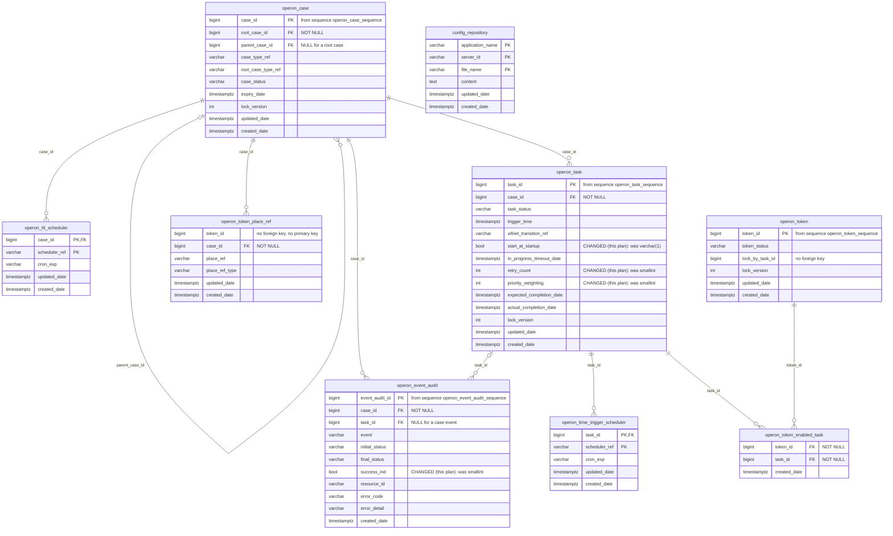

# Plan: Convert Operon's schema, SQL map, configuration and seed data from MySQL to PostgreSQL

**Status:** APPROVED
**Loop:** [Modernise Operon](261126-0754-modernise-operon-loop.md)

## Context

Operon was written against MySQL: the JDBC driver is `mysql-connector-java 5.1.5` with the class `org.gjt.mm.mysql.Driver`, ids
come from MySQL-style "sequence tables" through Spring's `MySQLMaxValueIncrementer`, and the seed data is a MySQL dump. A
PostgreSQL schema script already exists (`operon/src/resources/META-INF/db/postgres/operon-postgres-schema.sql`, 162 lines, the
same 13 tables as the 138-line MySQL one) but it has never been run against the code.

The user decided to move to **PostgreSQL, run in Docker for development and testing**. This plan does the switch: it reviews the
Postgres script line by line against the MySQL script and the iBatis SQL map
`operon/src/main/java/com/hoodox/operon/persistence/ibatis/sqlmap/Case.xml` (484 lines), fixes what would break, writes a Postgres
seed script, replaces the driver and the id generators, and points the tests at the Docker database from
[the Docker database plan](261125-2111-docker-postgres-database-for-dev-and-test.md). MySQL support is removed, not kept beside it.

**Rule for this whole effort (user, 2026-11-26): modernisation keeps every feature behaving exactly as it does on MySQL today.** A
change is in this plan only when Postgres cannot run the code without it, and then it reproduces what MySQL does; anything else
is left as is.

The review found that the code would not run on Postgres as it is (details in *Approach*): one update statement uses syntax
Postgres rejects; six queries compare a text column with the number `1`; two columns get Java `boolean` values that Postgres will
not store in a text or small-integer column; MySQL's id generator and seed script use MySQL-only SQL; and the existing Postgres
"last updated" trigger overwrites the timestamp the code writes, where MySQL keeps it.

**Is this a data-touching plan?** Yes. It re-creates the same 13 tables and keeps every table, column name and relationship, but it
changes the type of two columns (to hold what the Java code actually writes), replaces the four sequence tables with real
sequences, adds the indexes MySQL already has, rewrites a stored function, and changes 6 statements in the SQL map. Each of those is in the skill's
definition (a column, an index, a stored procedure, a query). So `## Tables involved` is included below. There is no
`## Database changes per scenario`: no entry point changes and every scenario reads and writes the same rows as before, apart
from the two column types shown in *Tables involved*.

Intended outcome: every SQL statement the code runs works against the Dockerised Postgres and stores and matches the same rows
MySQL does; the test suite gives the same result as on MySQL (the baseline in
[Plan 1](261125-2110-rebuild-hoodox-commons-module.md) → *Test results today*); nothing in the repo refers to MySQL any more.

## Tables involved

Source: the schema script as this plan leaves it (`operon-postgres-schema.sql`), which keeps the column list of today's script
line for line; types use Postgres short names. **No live database was available to read rows or the catalog from** (nothing runs
the Postgres script today, and there is no non-production environment), so names come from the script, and the rows below are
labelled **example** or **derived**, except the `config_repository` row, read from a throwaway MySQL 5.5 loaded with the repo's
own scripts (2026-11-26).



**`config_repository` stands alone: it holds the workflow XML files themselves (read by `ConfigurationHelper` when
`useDatabase=true`), and nothing points at it.** The four `operon_*_sequence` tables of today's script become real sequences of
the same names (no columns, so not drawn).

| Part | Reads | Writes |
|---|---|---|
| `ConfigurationHelper` (`hoodox-commons`, unchanged) | `config_repository` | nothing |
| `insertCase`, `updateCaseStatus` (changed: `SET` clause) | `operon_case` | `operon_case` (insert, update) |
| 5 startup / cron selects, 6 places (changed: `start_at_startup = true`) | `operon_task`, `operon_case`, `operon_time_trigger_scheduler` | nothing |
| `findTokenPlaceRefByCaseId` (unchanged, see finding 4) | `operon_token_place_ref`, `operon_token` | nothing |
| `insertTask`, `updateTaskStatus` | `operon_task` | `operon_task` (insert, update) |
| `insertEventAudit` | — | `operon_event_audit` (insert) |
| id generators (changed: `PostgreSQLSequenceMaxValueIncrementer`) | the 4 sequences (`nextval`) | the 4 sequences (advance) |
| `update_timestamp()` trigger (changed) | the updated row | `updated_date` of that row |
| seed script `sample-test-data.sql` (new, Postgres) | — | `config_repository` (4 inserts, test database only) |

`config_repository` — what the seed loads, the row the test context reads (**real**: read on 2026-11-26 from a throwaway MySQL
5.5.62 loaded with today's `operon-mysql-schema.sql` and `sample-test-data.sql`; MySQL drops the six single backslashes of the
Windows path in this literal, finding 11, and the Postgres seed must give the same 311 characters):

```
select application_name, server_id, file_name, length(content) as content_chars
  from config_repository
 where application_name = 'tailorit' and server_id = 'default' and file_name = 'OperonRegistery.xml';

 application_name | server_id |      file_name      | content_chars
------------------+-----------+---------------------+---------------
 tailorit         | default   | OperonRegistery.xml |           311
(1 row)
```

`operon_task.start_at_startup` — how the same Java value `Boolean.TRUE` ends up stored (**derived** from the code: iBatis
binds a `Boolean` property with `setBoolean`; MySQL Connector/J 5.1.5 sends `1`/`0` (its `PreparedStatement.setBoolean` bytecode,
read with `javap` on 2026-11-26), which a `varchar(1)` column stores as the text `'1'`/`'0'`, so the schema comment's (and the
design document's, section 6.5.4) `'Y'/'N'` is not what the code writes; the `'N'` default is never used because the insert always
supplies the value. pgjdbc sends a real boolean, which Postgres refuses (on Postgres 18, verified 2026-11-26: into `varchar(1)`
`value too long`, into `smallint` `column ... is of type smallint but expression is of type boolean`).

What the six `START_AT_STARTUP = 1` queries match on MySQL today: MySQL compares a text column with a number as numbers, so `'1'`
matches and `'0'` does not. On Postgres, `boolean` + `= true` matches exactly the rows written with `Boolean.TRUE`, i.e. the same
rows. Reading back (`startAtStartup` result map, `getBoolean`) gives `true`/`false` on both.

```
select task_id, start_at_startup from operon_task where task_id = 41;   -- 41: illustrative id

-- MySQL today            -- Postgres, today's script       -- Postgres, this plan
 task_id | start_at_startup   result: ERROR: column "start_     task_id | start_at_startup
---------+------------------   at_startup" is of type          ---------+------------------
      41 | 1                   character varying but            41 | t
(1 row)                        expression is of type boolean   (1 row)
```

The same applies to `operon_event_audit.success_ind` (`EventAuditVo.successInd` is a `boolean`; MySQL `int(1)` stores `1`/`0`;
Postgres `boolean` stores `t`/`f` and reads back the same `boolean`).

## Approach

Review of the Postgres script against the MySQL script (`operon-mysql-schema.sql`) and `Case.xml`, one decision per finding.
Unquoted upper-case names (`CASE_ID`) fold to lower case in Postgres on both sides, and pgjdbc's `findColumn` ignores case, so
the iBatis result maps (`column="CASE_ID"`) need no change. `now()`, `CURRENT_TIMESTAMP`, `count(*)`, the parenthesised `union`,
`as assoc_case` aliases and `&lt;&gt;` all work in Postgres. `EVENT` and `CONTENT` are not reserved words in Postgres. There is no
`limit`, backtick or `auto_increment` in `Case.xml`. Status values are written and compared in lower case on both sides
(`Const.java:12-100`), so MySQL's case-insensitive default collation was not hiding a mismatch.

| # | Finding | Decision |
|---|---|---|
| 1 | `UPDATE operon_case SET operon_case.CASE_STATUS=...` (`Case.xml:82-87`): Postgres rejects a table-qualified column in `SET`. | Unqualified column names. |
| 2 | `operon_task.START_AT_STARTUP = 1` in 6 places of 5 queries (`Case.xml:98, 370, 382, 395, 409, 426`): `varchar = integer` has no operator in Postgres. | Column becomes `boolean`; queries use `= true`. |
| 3 | `START_AT_STARTUP varchar(1)` (`postgres-schema.sql:60`) and `SUCCESS_IND smallint` (`:116`) get Java booleans (see *Tables involved*). | Both `boolean NOT NULL default false` / `boolean NOT NULL`. |
| 4 | `operon_token_place_PLACE_REF` (`Case.xml:230`, statement `findTokenPlaceRefByCaseId`, called only for an AND-join at `WorkflowCoreEngineImpl.java:815`) names a column that does not exist; it fails the same way on MySQL today. | **Left as is** (not a Postgres requirement; observed, left as is). None of the nets the tests load has an AND-join, so no test reaches it. |
| 5 | Sequence tables (`postgres-schema.sql:21-22, 51-52, 73-74, 106-107`) copy MySQL's emulation; Spring's `MySQLMaxValueIncrementer` (`operon-dataAccessContext-local.xml:77-99`) uses MySQL's `LAST_INSERT_ID()`, which Postgres does not have. | Required. `CREATE SEQUENCE` of the same names; Spring's `PostgreSQLSequenceMaxValueIncrementer` (present in `spring-jdbc 2.5.6.SEC03`, it runs `select nextval('<name>')`). Ids stay unique and increasing from 1, as today; only the gaps differ (MySQL's incrementer reserves blocks of 10 per JVM, so a restart skips ahead). |
| 6 | `RETRY_COUNT`, `PRIORITY_WEIGHTING` are `smallint` (`:62-63`, max 32767) but MySQL's `int(20)` holds 32-bit values. | `integer`, the same range as MySQL. Defaults stay `0`, as in MySQL. |
| 7 | MySQL `KEY`s index every foreign-key column (`mysql-schema.sql:27-28, 65, 90, 98-99, 123-124`); Postgres does not index foreign keys by itself. | Carry MySQL's existing indexes over: `CREATE INDEX` for each of the 8 (the two that are a primary-key prefix are skipped). No effect on results. |
| 8 | MySQL `ON UPDATE CURRENT_TIMESTAMP` on `UPDATED_DATE` (7 tables) sets the time only when a row changes **and** the statement does not assign `UPDATED_DATE` itself. All three update statements (`updateCaseStatus`, `updateToken`, `updateTaskStatus`) assign it (`#updatedDate#`, the Java clock), so MySQL keeps the Java value. The existing Postgres trigger (`:137-145`) overwrites it with the database clock whenever the row changes (verified on Postgres 18, 2026-11-26). It does **not** drop updates: record `!=` treats NULLs as equal (verified the same day; the earlier note in this plan said otherwise). | Required to keep MySQL's result: set the time only when the row changed and `UPDATED_DATE` did not (see Code changes). `EXECUTE PROCEDURE` stays (accepted by Postgres 18, verified). |
| 9 | MySQL `ON UPDATE CURRENT_TIMESTAMP` is emulated by finding 8; MySQL column comments are not carried over (`-- TODO Add Comments`, `:1`). | Keep emulation; comments out of scope. |
| 10 | Drop script (`postgres-drop-schema.sql:10-22`) drops sequence *tables*. | `drop sequence if exists` for the four. |
| 11 | Seed `sample-test-data.sql` is MySQL-only: `USE tailorit;` (`:1, :9`), backticks (`:4, :11`), MySQL backslash escapes `\r\n\t\"\'` in the first insert (`:5-6`). The second insert (`:11-574`) is plain text with `''` quotes and one Windows path with single backslashes (`:573`), which MySQL drops when it stores the text. | New Postgres seed: same 4 rows holding exactly the text MySQL stores: every literal decoded the MySQL way (escapes turned into their characters, a backslash before any other character dropped), then written as standard Postgres strings; no `USE`, no backticks. |
| 12 | `operon-mysql-*.sql` and the MySQL `sample-test-data.sql` | Deleted (history stays in git). |

### Code changes

**`operon-postgres-schema.sql:21-22`** (same for `:51-52`, `:73-74`, `:106-107`) — *Before:*

```sql
create table operon_case_sequence (id bigint not null); 
insert into operon_case_sequence values(0);
```

*After:*

```sql
create sequence operon_case_sequence start with 1;
```

**`operon-postgres-schema.sql:60-63`** — *Before:*

```sql
  START_AT_STARTUP varchar(1) NOT NULL default 'N',
  IN_PROGRESS_TIMEOUT_DATE timestamp with time zone NULL,
  RETRY_COUNT smallint NOT NULL default '0',
  PRIORITY_WEIGHTING smallint NOT NULL default '0',
```

*After:*

```sql
  START_AT_STARTUP boolean NOT NULL default false,
  IN_PROGRESS_TIMEOUT_DATE timestamp with time zone NULL,
  RETRY_COUNT integer NOT NULL default 0,
  PRIORITY_WEIGHTING integer NOT NULL default 0,
```

**`operon-postgres-schema.sql:116`** — *Before:* `  SUCCESS_IND smallint NOT NULL,` — *After:* `  SUCCESS_IND boolean NOT NULL,`

**`operon-postgres-schema.sql:137-160`** — *Before:*

```sql
CREATE FUNCTION update_timestamp() RETURNS trigger AS $update_timestamp$
    BEGIN
	    IF (NEW != OLD) THEN
        	NEW.UPDATED_DATE = CURRENT_TIMESTAMP;
        	RETURN NEW;
    	END IF;
    	RETURN OLD;    
    END;
$update_timestamp$ LANGUAGE plpgsql;

CREATE TRIGGER update_timestamp BEFORE UPDATE ON config_repository
    FOR EACH ROW EXECUTE PROCEDURE update_timestamp();
```

*After* (the 7 `CREATE TRIGGER` statements stay as they are; MySQL's rule: change the time only when the row changed and the
statement did not set it):

```sql
CREATE FUNCTION update_timestamp() RETURNS trigger AS $update_timestamp$
    BEGIN
        IF NEW IS DISTINCT FROM OLD
           AND NEW.UPDATED_DATE IS NOT DISTINCT FROM OLD.UPDATED_DATE THEN
            NEW.UPDATED_DATE = CURRENT_TIMESTAMP;
        END IF;
        RETURN NEW;
    END;
$update_timestamp$ LANGUAGE plpgsql;
```

Checked on Postgres 18 (2026-11-26, throwaway container): an explicit `updated_date` is kept; an update without it gets the
current time; an update that changes nothing keeps the old time; setting a column to NULL is saved. (One case cannot be told
apart: a statement that sets `UPDATED_DATE` to its old value gets the current time, MySQL would keep it. Operon always writes a
new `java.util.Date`, so it does not happen.)

New, after the tables (finding 7):

```sql
CREATE INDEX operon_case_parent_case_id_idx ON operon_case (PARENT_CASE_ID);
CREATE INDEX operon_case_root_case_id_idx ON operon_case (ROOT_CASE_ID);
CREATE INDEX operon_task_case_id_idx ON operon_task (CASE_ID);
CREATE INDEX operon_token_place_ref_case_id_idx ON operon_token_place_ref (CASE_ID);
CREATE INDEX operon_token_enabled_task_token_id_idx ON operon_token_enabled_task (TOKEN_ID);
CREATE INDEX operon_token_enabled_task_task_id_idx ON operon_token_enabled_task (TASK_ID);
CREATE INDEX operon_event_audit_case_id_idx ON operon_event_audit (CASE_ID);
CREATE INDEX operon_event_audit_task_id_idx ON operon_event_audit (TASK_ID);
```

**`Case.xml:82-87`** — *Before:*

```xml
		UPDATE operon_case 
			SET operon_case.CASE_STATUS=#caseStatus#, 
				operon_case.LOCK_VERSION=#newLockVersion#,
				operon_case.UPDATED_DATE=#updatedDate#
		WHERE operon_case.CASE_ID=#caseId#
			  AND LOCK_VERSION = #currentLockVersion#
```

*After:*

```xml
		UPDATE operon_case 
			SET CASE_STATUS=#caseStatus#, 
				LOCK_VERSION=#newLockVersion#,
				UPDATED_DATE=#updatedDate#
		WHERE operon_case.CASE_ID=#caseId#
			  AND LOCK_VERSION = #currentLockVersion#
```

**`Case.xml:98`** (and `:370`, `:382`, `:395`, `:409`, `:426`) — *Before:* `and operon_task.START_AT_STARTUP = 1` —
*After:* `and operon_task.START_AT_STARTUP = true`

**`operon-dataAccessContext-local.xml:59-63`** and **`:77-99`** — *Before:*

```xml
	<bean id="sequenceDaoAware" abstract="true">
		<property name="dataSource"><ref local="dataSource"/></property>
		<property name="columnName"><value>id</value></property>
		<property name="cacheSize"><value>10</value></property>
	</bean>
...
	<bean id="caseSequenceDao" class="org.springframework.jdbc.support.incrementer.MySQLMaxValueIncrementer" 
		singleton="true"
		parent="sequenceDaoAware">
		<property name="incrementerName"><value>operon_case_sequence</value></property>
	</bean>
```

*After* (the other three incrementers change the same way; a sequence incrementer has no `columnName`/`cacheSize`):

```xml
	<bean id="sequenceDaoAware" abstract="true">
		<property name="dataSource"><ref local="dataSource"/></property>
	</bean>
...
	<bean id="caseSequenceDao" class="org.springframework.jdbc.support.incrementer.PostgreSQLSequenceMaxValueIncrementer" 
		singleton="true"
		parent="sequenceDaoAware">
		<property name="incrementerName"><value>operon_case_sequence</value></property>
	</bean>
```

The `PropertyPlaceholderConfigurer` (`operon-dataAccessContext-local.xml:17-24`) stays as it is (not needed for Postgres).

**`operon/src/test/resources/META-INF/jdbc.properties:11-15`** — *Before:*

```properties
#jdbc.driverClassName=jdbc:mysql://<host>:<port>/<instance>
jdbc.driverClassName=org.gjt.mm.mysql.Driver
jdbc.url=jdbc:mysql://localhost:3306/tailorit
jdbc.username=tailorituser
jdbc.password=tailorituser
```

*After* (throwaway local credentials, unchanged; the database from Plan 2):

```properties
jdbc.driverClassName=org.postgresql.Driver
jdbc.url=jdbc:postgresql://localhost:15432/tailorit
jdbc.username=tailorituser
jdbc.password=tailorituser
```

**`operon/pom.xml:28`** and **`:132-137`** — *Before:*

```xml
		<mysql-connector-java.version>5.1.5</mysql-connector-java.version>
...
		<dependency>
			<groupId>mysql</groupId>
			<artifactId>mysql-connector-java</artifactId>
			<version>${mysql-connector-java.version}</version>
			<type>jar</type>
		</dependency>		
```

*After:* `org.postgresql:postgresql` 42.7.15 (latest on Maven Central, checked 2026-11-25; the 42.7 line still runs on Java 8,
which is what Plan 1 builds for):

```xml
		<postgresql.version>42.7.15</postgresql.version>
...
		<dependency>
			<groupId>org.postgresql</groupId>
			<artifactId>postgresql</artifactId>
			<version>${postgresql.version}</version>
			<scope>runtime</scope>
		</dependency>
```

**`compose.yaml`** (from Plan 2) — *Before:* only the `10-operon-schema.sql` mount. *After:* adds
`- ./operon/src/resources/META-INF/db/postgres/sample-test-data.sql:/docker-entrypoint-initdb.d/20-sample-test-data.sql:ro`.

## Scope

- **In:** the Postgres schema, drop and seed scripts; `Case.xml`; the test Spring data-access file and `jdbc.properties`; the
  driver in `operon/pom.xml`; the seed mount in `compose.yaml`; removing the MySQL scripts; README wording.
- **Out:** MyBatis, Spring, connection-pool or other library upgrades ([Plan 4](261125-2113-upgrade-java-libraries-and-maven-to-latest.md));
  Flyway-style migrations (there is no deployed database to migrate); porting MySQL column comments; production configuration
  (the repo has none: the Spring files are test resources and host applications bring their own).

## Implementation

**Folders touched** (this repo has no `.claude/rules/`, so no scoped rule applies):
- `operon/src/resources/META-INF/db/postgres/` → no scoped rule
- `operon/src/resources/META-INF/db/mysql/` (deleted) → no scoped rule
- `operon/src/main/java/com/hoodox/operon/persistence/ibatis/sqlmap/` → no scoped rule
- `operon/src/test/resources/META-INF/` → no scoped rule
- `operon/` (`pom.xml`) → no scoped rule
- repo root (`compose.yaml`, `README.md`) → no scoped rule

**Flow:** none — the same statements run in the same order through the same DAO; only their SQL dialect, two column types and the
id source change, with no new branch or entry point.

1. Schema
   - edit: `operon/src/resources/META-INF/db/postgres/operon-postgres-schema.sql` — findings 3, 5, 6, 7, 8 (see Approach)
   - edit: `operon/src/resources/META-INF/db/postgres/operon-postgres-drop-schema.sql` — triggers and function first (as today),
     then tables child-first (as today), then `drop sequence if exists` for the four sequences
2. Seed data
   - new: `operon/src/resources/META-INF/db/postgres/sample-test-data.sql` — finding 11: two `insert into config_repository
     (APPLICATION_NAME, SERVER_ID, FILE_NAME, CONTENT, UPDATED_DATE, CREATED_DATE) values ...` statements with the same four rows
     and timestamps as `mysql/sample-test-data.sql`; rows 1-2 (source lines 5-6) as `E'...'` literals, rows 3-4 (source lines
     11-574) also decoded the MySQL way (finding 11); build it with a small one-off `python3 -I` conversion and check the four
     `content` values by comparing `md5(content)` against the same text decoded from the MySQL file
3. SQL map
   - edit: `operon/src/main/java/com/hoodox/operon/persistence/ibatis/sqlmap/Case.xml` — findings 1 and 2 only (line 230 stays)
4. Spring and JDBC configuration
   - edit: `operon/src/test/resources/META-INF/operon-dataAccessContext-local.xml` — incrementers, `sequenceDaoAware`
   - edit: `operon/src/test/resources/META-INF/jdbc.properties` — driver and URL
5. Driver
   - edit: `operon/pom.xml` — remove `mysql-connector-java` (property line 28, dependency lines 132-137); add `postgresql` 42.7.15
6. Docker seed
   - edit: `compose.yaml` — mount `sample-test-data.sql` as `20-sample-test-data.sql`
7. Remove MySQL
   - delete: `operon/src/resources/META-INF/db/mysql/operon-mysql-schema.sql`, `operon-mysql-drop-schema.sql`, `sample-test-data.sql`
   - edit: `README.md` — database section says PostgreSQL only; `operon/README.txt` prerequisites line "4. Mysql" → "4. Docker
     (PostgreSQL, see README.md)", and its "Configuring Mysql" section (`README.txt:118-162`, from the `====` line above that
     title to the `mysqladmin shutdown` step) → a three-line "Database" section pointing to README.md's Docker database section

## Verification

```bash
scripts/operon-db.sh reset && scripts/operon-db.sh logs | grep -E "10-operon-schema|20-sample-test-data|ERROR"
```
Expected: both scripts listed, no `ERROR`.

```bash
scripts/operon-db.sh psql -c '\ds' -c '\di' \
  -c "select file_name, md5(content) from config_repository order by file_name;"
```
Expected: 4 sequences (`operon_case_sequence`, `operon_event_audit_sequence`, `operon_task_sequence`, `operon_token_sequence`);
the 8 new `*_idx` indexes plus the primary keys; 4 seed rows whose `md5` values equal those printed by the conversion step.

```bash
mvn -B clean install && mvn -B -Pdb-tests -pl operon verify
```
Expected: `BUILD SUCCESS`; the 9 `testng.xml` tests give Plan 1's baseline (2 named failures). The 5 `WorkflowEngineTest` tests
give the same result as on MySQL today: the Spring context reads `OperonRegistery.xml` and the net from `config_repository`
**on Postgres** (log shows the registry loaded, no SQL or connection error) and then stops at the known
`ClassCastException` at `WopedJAXBHelper.java:324` (Plan 1, *Test results today*). That is exactly what they do on MySQL today
(re-run 2026-11-26 on MySQL 5.5 with the original toolchain, Plan 1 → *Original toolchain, re-run*). Any SQL error is a failure of this plan.
If the user's answer to Plan 1's Open question 1 makes those tests runnable, the expectation becomes the result they give on
MySQL, and this Verification is updated first.

Statement check (the engine cannot start, so the SQL is exercised directly). A throwaway TestNG class, written and compiled in a
new folder under the session scratchpad (never in the repo), loads only `/META-INF/operon-dataAccessContext-local.xml` from
`operon/target/test-classes` and calls the `caseDao` bean (`CaseDao.java`): `createCase` + `updateCaseStatus`; `createToken` +
`updateToken`; `addEventAudit` with `successInd` `true` and `false`; and for each of the five statements behind
`Case.xml:98, 370, 382, 395, 409, 426` (`findAllExistingOpenCaseCronExp`, `findActivitiesForStartup`,
`findAutoWorkItemsForStartup`, `findOverdueTimedWorkItemsForStartup`, `findNotOverdueExplicitTimedWorkItemsForStartup`, the last
holding both `:409` and its sub-select at `:426`) two rows made with `createTask` (plus `addTimeTriggerSchedulers` / `addTimeToLiveSchedulers`
where the statement joins them) that meet all its other conditions and differ only in `startAtStartup` (`TRUE` / `FALSE`), then
`updateTaskStatus`. Expected: no exception; each finder returns the `TRUE` row and never the `FALSE` one (what `= 1` matches on
MySQL); a stale lock version raises `DaoLockVersionException`; ids come from the four sequences. The class and its output stay
in the scratchpad; record the result in `## Status`.

After the test run, read-only checks on the local test database (counts depend on the run, so only shapes are asserted):

```bash
scripts/operon-db.sh psql \
  -c "select last_value > 1 as ids_used from operon_case_sequence;" \
  -c "select count(*) > 0 as cases from operon_case;" \
  -c "select start_at_startup, count(*) from operon_task group by 1;" \
  -c "select success_ind, count(*) from operon_event_audit group by 1;"
```
Expected: `ids_used = t`, `cases = t`; `start_at_startup` and `success_ind` show only `t`/`f` values.

```bash
scripts/operon-db.sh psql -c "select case_id, updated_date from operon_case order by case_id desc limit 1;"
```
Expected: the `updated_date` equals the `java.util.Date` the statement check passed to `updateCaseStatus` (MySQL behaviour), not
the database time of the update.

```bash
grep -rniE "mysql|gjt\.mm|ENGINE=|MYISAM|LAST_INSERT_ID|MySQLMaxValue" --exclude-dir=.git --exclude-dir=todos --exclude-dir=documents \
  --exclude-dir=target --exclude='.classpath*' .
```
Expected: no output (the design documents under `operon/documents/` and the Eclipse `.classpath`/`.classpath.bak` files, which
still list the MySQL driver jar, are excluded on purpose and not edited: Plan 1 leaves Eclipse files out of scope).

## Risks & rollback

- `WorkflowEngineTest` cannot get past loading the sample net on any database today (Plan 1, *Test results today*), so the
  engine's own use of the SQL is only covered by the statement check above, not end to end. Anything else found that Postgres
  needs is added here first (dated note), per the plan-first rule; anything that would change what MySQL does is not.
- Observed, left as is: `findTokenPlaceRefByCaseId` names a non-existent column (finding 4).
- Postgres 19 is six days old (GA 2026-11-19). If the image or pgjdbc 42.7.15 shows a problem specific to 19, pin `postgres:18` in
  `compose.yaml` and record it.
- Rollback: revert the commit; the database is a throwaway Docker volume (`scripts/operon-db.sh reset`). No real data exists in
  any MySQL or Postgres database for this repo, so there is nothing to migrate or lose.

## Open questions

1. **End-to-end database tests.** Same cause as [Plan 1](261125-2110-rebuild-hoodox-commons-module.md)'s Open question 1: the 5
   `WorkflowEngineTest` tests stop while loading the sample net, on MySQL and Postgres alike, so this plan can prove the SQL only
   statement by statement. **Answered 2026-11-26** (Plan 1, Open question 1): on MySQL 5.5 with the original toolchain the 5
   tests read the net from `config_repository` and stop at the same cast, so the Verification above is today's MySQL result.

## Dependencies

### Blocks this plan (must be done first)
- [Rebuild hoodox-commons and make a clean checkout build green](261125-2110-rebuild-hoodox-commons-module.md) — PLANNED;
  **blocked** (nothing compiles without it; it also creates the `db-tests` profile)
- [A PostgreSQL database in Docker](261125-2111-docker-postgres-database-for-dev-and-test.md) — PLANNED; **blocked** (the
  verification runs against it; this plan edits its `compose.yaml`)

### Blocked by this plan (cannot start until this is done)
- [Upgrade Java, libraries and Maven to latest](261125-2113-upgrade-java-libraries-and-maven-to-latest.md) — PLANNED / NEEDS
  RE-REVIEW; **blocked** (its MyBatis step converts the Postgres-ready SQL map)

## Status

- 2026-11-25 (operon): PLANNED — written by the owning team after reading both schema scripts, both drop scripts,
  `sample-test-data.sql`, `Case.xml`, `CaseSqlMapDao.java`, the value objects and the test Spring/JDBC files; the ERD is the
  owning team's own (self-approved; checked with `h:mermaid-check`). No database was available, so no row is real. Awaiting the
  user's approval.
- 2026-11-26 (operon): PLANNED — joined the loop [Modernise Operon](261126-0754-modernise-operon-loop.md), created at the user's request.
- 2026-11-26 (operon): PLANNED / NEEDS RE-REVIEW — owning-team re-review under the user's rule "keep every feature behaving as
  today". Removed: the `Case.xml:230` column-name fix (fails the same on MySQL; not a Postgres need), the
  `systemPropertiesModeName` override, and `EXECUTE FUNCTION`. Corrected: the trigger finding (the existing trigger does not drop
  updates; it overwrites the code's own `UPDATED_DATE`, which MySQL keeps) and its rewrite now follows MySQL's rule; the seed
  keeps exactly the text MySQL stores. Kept, each with how it matches MySQL: unqualified `SET`, `boolean` columns with `= true`,
  sequences, `integer` counters, MySQL's indexes, seed, driver. Verified by running on Postgres 18 (throwaway container) and by
  reading Connector/J 5.1.5's `setBoolean` bytecode. Verification now expects the MySQL baseline plus a statement-level check;
  Open question 1 added. Stays `NEEDS RE-REVIEW` until Plan 1's Open question 1 is answered.
- 2026-11-26 (operon): PLANNED / RE-REVIEW DONE — independent owning-team re-review. Plan 1's Open question 1 is answered by
  evidence, so this plan's Open question 1 and Verification stand as written (the 5 database tests stop at the same cast on
  MySQL 5.5 today). Checked on a throwaway MySQL 5.5.62 with Connector/J 5.1.5: `setBoolean` stores `'1'`/`'0'` in a
  `varchar(1)` and `= 1` matches only `'1'` (finding 2-3 confirmed); the seed's `OperonRegistery.xml` row is 311 characters
  (the example said 317; corrected, labelled real). Checked on `postgres:19`: the new `update_timestamp()` keeps an explicit
  `updated_date`, sets it otherwise, `EXECUTE PROCEDURE` is accepted; `create sequence` + `nextval` start at 1. Fixed two
  things that would have stopped Verification: the MySQL `grep` also hit the Eclipse `.classpath` files and README.txt's
  "Configuring Mysql" section (step 7 now replaces that section; the grep excludes `.classpath*` and `target`).
- 2026-11-26 (operon): APPROVED — approved by the user ("approve the plans"). Still in `backlog/`, so nothing may be built until the loop is picked into `todos/`.
- 2026-11-26 (operon): APPROVED — picked from `backlog/` into `todos/` with the Modernise Operon loop, on the user's go-ahead. Not started: the user is clearing the session first; the new session dispatches.
