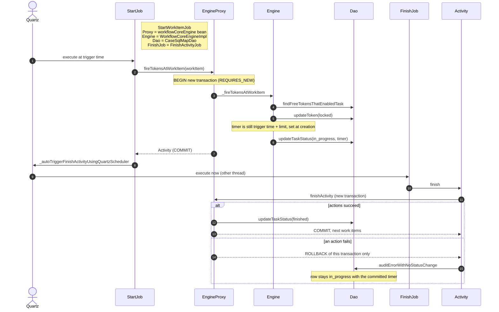
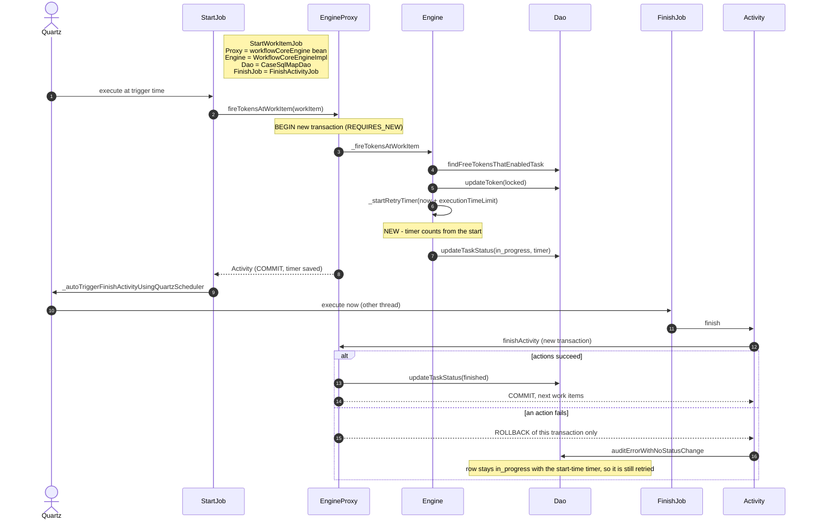
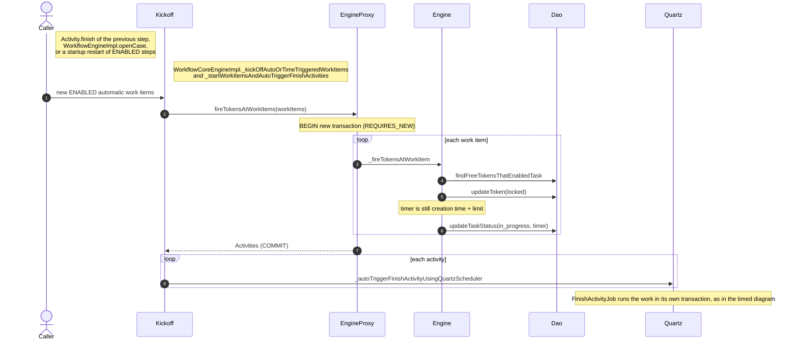
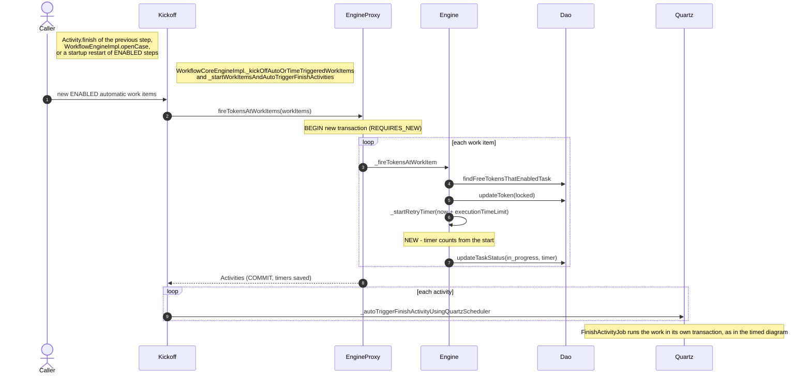
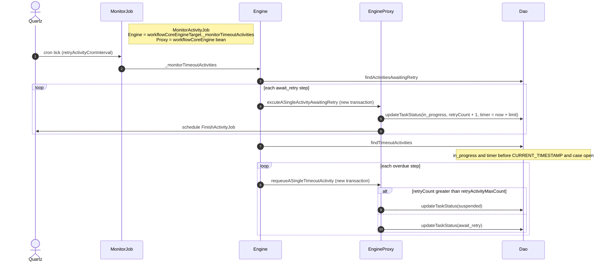

# Plan: Start an automatic or timed step's retry timer when the step starts running, not when it is created

**Status:** PLANNED
**Requested by:** [Retry an automatic step that fails on its very first run](../../../../woperon/woperon-python/todos/done/261124-1700-retry-a-step-that-fails-on-its-first-run.md) in `woperon-python` (open question 1, decided by the owner on 2026-11-24)

> **ON HOLD** — on hold: user rule, no feature behaviour changes (2026-11-26); not to be built unless the user reverses it.
> This plan changes when the retry timer of an automatic or timed step starts, i.e. how the retry feature behaves today.
> Its content is kept unchanged for reference.

## Context

Operon retries an automatic or timed step that does not finish in time. Each such step carries a "retry me if not finished by"
time (the in-progress timeout). The retry monitor, which runs on a cron, finds any step that is `IN_PROGRESS` with that time in the
past, queues it for a retry, and re-runs it on the next tick; after the maximum number of retries it suspends the step.

Today that time is set **when the step is created**: for an automatic step, creation time plus the step's execution time limit; for
a timed step, its trigger time plus the limit (`WorkflowCoreEngineImpl.java`, about lines 840-857). It is set again (to now plus the
limit) only when a retry starts (about line 2397). Starting the step (status `IN_PROGRESS`) does not touch it.

That is fine while a step starts right after it is created. It is not fine when a step waits between creation and start, because
the waiting time is spent from the step's own allowance.

Example (derived from reading the code; not run): a timed step "send the reminder SMS" is due at 10:00 and its limit is 5 minutes,
so its time is set to 10:05. Timed steps are started by a cron that runs every few minutes, so it may pick the step up at 10:04:59.
The step now has 1 second left. The SMS takes 20 seconds, which is normal, but at 10:05 the monitor sees "`IN_PROGRESS` and past its
time", treats a healthy step as stuck, queues it and runs it again, so the customer gets two SMS messages. If the step had started
at 10:04:59 with its time counted from then (10:09:59), it would have had its full 5 minutes.

> **Correction (operon, owning team, 2026-11-25):** only timed steps with an *implicit* delay (one tied to a named scheduler) are
> started by a cron (`WorkflowCoreEngineImpl._triggerExpiredCasesOrStartDueWorkItems`, lines 1649-1731). A timed step with an
> *explicit* delay gets a one-shot Quartz trigger at its exact trigger time (`_setStartWorkItemTimerUsingQuartzScheduler`, lines
> 1330-1380, run by `StartWorkItemJob`), so its wait is normally short (a busy Quartz thread pool or a restart can still delay it).
> The example holds as written for implicit-delay timed steps, and for any step whose start is delayed.

> **Correction (operon, owning team, 2026-11-26):** a late start alone causes no harm. The second run happens only if a monitor
> check falls while the step is still `IN_PROGRESS` and its timer has passed. In the example, that is the 10:05 check during the
> 20-second send. This can be more likely than "occasional": in the test context and the example net, the monitor and the implicit
> scheduler both use the cron `0 0/5 * * * ?` (`applicationContext.xml:33`, `ExampleNetNonWopedFormat.xml:453`), so both fire at
> the same moments and a check can follow a late start almost at once (inferred; not run).

The same happens to an automatic step re-run by the restart path after a long outage: its time was set at creation, long ago.

> **Correction (operon, owning team, 2026-11-25; call count corrected 2026-11-26):** startup makes four restart calls
> (`WorkflowCoreEngineImpl._initialise`, lines 125-129). The fourth, `_reScheduledNotOverdueExplicitTimedWorkItemsAtStartup`,
> re-arms the timers of explicit timed steps not yet due; they later start through `StartWorkItemJob` and the normal start, so this
> plan covers them. Of the other three, two start steps that are still waiting (`ENABLED`) and go through the normal start, so this plan fixes them:
> `_restartAutoWorkitemsAtStartup` (lines 1568-1592) and `_restartExpiredTimedWorkitemsAtStartup` (lines 1594-1618). The third,
> `_restartActivitiesAtStartup` (lines 1540-1566), re-runs steps that were already `IN_PROGRESS` when the server stopped; it hands them
> straight to the finish job without changing their status, so it does **not** pass through the start and this plan does not reset
> their timer. See Open question 2.

The Woperon port of Operon (`woperon-python`) has decided to count from the start instead, as part of fixing a different gap
(there, the time was never set on a first run). Its owner asked for the same behaviour to be planned for Operon, so the two engines
keep behaving alike. Operon itself does **not** have that other gap: because its time is set at creation, a step that fails on
its first run is already retried.

> **Verified (operon, owning team, 2026-11-25):** confirmed from the code. The start (`IN_PROGRESS`) is committed in its own
> transaction before the step's work runs (see Approach), so when the work fails only the work's transaction rolls back; the step
> stays `IN_PROGRESS` with its creation-time timer, and the monitor retries it once that time passes.

Intended outcome: a step's retry timer starts counting when the step starts running, so a step that waited before starting is
not retried while it is running normally.

**What this plan does not fix** (operon, 2026-11-26). It removes only the double run caused by time spent waiting *before* the
start. These remain:

- A step that really runs longer than its limit is still run again; nothing cancels the first run. The first run's actions still
  execute, then its `finished` update fails on the old lock version and rolls back, so outside effects (SMS, email) can happen twice.
- The limit counts from the start commit, so time then spent queuing for a Quartz thread (3 in the test `quartz.properties`) still
  uses up the allowance.
- Steps already `IN_PROGRESS` at a server restart keep their old timer (Open question 2).
- **Suspected, not confirmed** (the Quartz 1.8.6 behaviour was not checked): queuing a retry while the first run is still executing
  reuses the job name `Activity_<taskId>`, which could throw and end the whole monitor check, skipping the other overdue steps
  until that run ends. A lock-version clash when a step finishes during a check could end that check the same way. Both are in
  today's code and are not changed here; a test that retries a still-running step could hit them.

## Approach

One change in behaviour: the retry timer is (re)set at the moment a step moves to `IN_PROGRESS`, to now plus the step's own
execution time limit. Today's creation-time value stays only as a first estimate; the start overwrites it. The write is saved
separately from the step's own work, so a step that fails on its first run keeps its timer and is still retried. Everything else
in the retry loop stays as it is (count, maximum, two ticks, finder, restart path). This is the behaviour `woperon-python` now
plans, which differs from Operon at exactly this one point.

### Owning team's review of the code (operon, 2026-11-25)

**Where a step moves to `IN_PROGRESS`.** Three places call
`_updateWorkItemStatus(..., Const.TASK_STATUS_in_progress, ...)` in
`operon/src/main/java/com/hoodox/operon/workflow/WorkflowCoreEngineImpl.java`:

| Line | Method | Which steps | This plan |
|---|---|---|---|
| 1056 | `_fireTokensAtWorkItem` (private static), called by `fireTokensAtWorkItems` (l. 940) and `fireTokensAtWorkItem` (l. 956) | first start of automatic, timed **and manual** steps | **changes here**, guarded to automatic and timed only |
| 1143 | `fireTokensAtWorkItemForMessageTrigger` | message and manual steps only (start and finish in one transaction) | unchanged (no retry timer for these) |
| 2398 | `excuteASingleActivityAwaitingRetry` | a retry re-run | unchanged (already sets now + limit at l. 2397) |

**The timeout column is already persisted by the status write.** `_updateWorkItemStatus` (l. 1186-1205) calls
`caseDao.updateTaskStatus(taskVo, currentLockVersion)`; `CaseSqlMapDao.updateTaskStatus`
(`operon/src/main/java/com/hoodox/operon/persistence/ibatis/sqlmapdao/CaseSqlMapDao.java:151-170`) passes
`taskVo.getInProgressTimeout()` (l. 160), and the iBatis statement `updateTaskStatus`
(`operon/src/main/java/com/hoodox/operon/persistence/ibatis/sqlmap/Case.xml:311-321`) writes
`IN_PROGRESS_TIMEOUT_DATE=#inProgressTimeout#` (l. 318). So setting the value on the `TaskVo` before line 1056 is enough: no
DAO, SQL or schema change.

**Which transaction the start is in, and why it survives the step's failure.** The transaction boundaries are Spring 2.5
`@Transactional` annotations on the interface
`operon/src/main/java/com/hoodox/operon/workflow/WorkflowCoreEngine.java`, applied by a `TransactionProxyFactoryBean` with an
`AnnotationTransactionAttributeSource` (bean `workflowCoreEngine` wrapping `workflowCoreEngineTarget`, wired in
`operon/src/test/resources/META-INF/applicationContext.xml`; a host application wires the same proxy, or today's retry would not
work either) over a `DataSourceTransactionManager` (`operon-dataAccessContext-local.xml`).

- `fireTokensAtWorkItem` — `REQUIRES_NEW` (`WorkflowCoreEngine.java:136`); `fireTokensAtWorkItems` — `REQUIRES_NEW` (l. 193).
  Both callers go through the proxy bean, not `this`: `StartWorkItemJob` (explicit timed steps) and
  `WorkflowCoreEngineImpl._startWorkItemsAndAutoTriggerFinishActivities` (l. 1444-1447; automatic steps, implicit timed steps,
  restarts). So the start, including the `IN_PROGRESS_TIMEOUT_DATE` it writes, **commits when that call returns**.
- Only after that commit does the caller schedule the step's work as a separate Quartz job
  (`_autoTriggerFinishActivityUsingQuartzScheduler`, l. 1284-1318 → `FinishActivityJob` → `Activity.finish` →
  `workflowCoreEngine.finishActivity`, `REQUIRES_NEW`, `WorkflowCoreEngine.java:205`), on another thread and in its own
  transaction.
- When the work fails, that transaction rolls back; `Activity.finish` (`Activity.java:89-119`) audits the error with no status
  change and rethrows; `FinishActivityJob` logs and swallows it. The row stays `in_progress` with the committed timer.

**Chosen mechanism: none new is needed.** The "saved separately" requirement is already met by the existing `REQUIRES_NEW`
start transaction. No extra `REQUIRES_NEW` method and no earlier separate update are added.

**How the monitor decides a step is overdue (unchanged).** `MonitorActivityJob` runs `_monitorTimeoutActivities` (l. 2342-2368) on
the cron `retryActivityCronInterval` (`0 0/5 * * * ?` = every 5 minutes in the test context). Each tick it first re-runs every
`await_retry` step (`excuteASingleActivityAwaitingRetry`: `retryCount + 1`, timer = now + limit, `in_progress`, schedule finish
job), then requeues every overdue step from `findTimeoutActivities` (`Case.xml:343-354`: `TASK_STATUS = 'in_progress'`,
`IN_PROGRESS_TIMEOUT_DATE` not null and `< CURRENT_TIMESTAMP`, case and root case `open`). `requeueASingleTimeoutActivity`
(l. 2459-2488) suspends the step when `retryCount > retryActivityMaxCount` (l. 2465), else sets `await_retry`. Note for the
tests: because the test is `>` and the count starts at 0, with a maximum of 3 a step is re-run 4 times (counts 1-4) and is
suspended at the timeout after the 4th re-run.

**Not a data-touching plan:** no table, column, index or SQL statement changes; the existing `updateTaskStatus` UPDATE already
writes `IN_PROGRESS_TIMEOUT_DATE`, only the value it receives at start differs. So no `## Tables involved`.

### The code change

To keep the timer rule testable without a database, the rule goes into one small package-private static helper, called from
`_fireTokensAtWorkItem` just before the status write.

*Before* — `operon/src/main/java/com/hoodox/operon/workflow/WorkflowCoreEngineImpl.java:1053-1056`:

```java
		//=================================
		// Update WorkItem to IN_PROGRESS
		//=================================
		_updateWorkItemStatus(taskVo, triggerContext, Const.TASK_EVENT_fire, Const.TASK_STATUS_in_progress, null, caseDao);
```

*After*:

```java
		//=================================
		// Start the retry timer now, so an automatic or
		// timed step gets its full execution time limit
		// from the moment it starts running. Committed with
		// the IN_PROGRESS status by this REQUIRES_NEW call,
		// before the step's work runs in its own transaction.
		//=================================
		_startRetryTimer(taskVo, transition, System.currentTimeMillis());

		//=================================
		// Update WorkItem to IN_PROGRESS
		//=================================
		_updateWorkItemStatus(taskVo, triggerContext, Const.TASK_EVENT_fire, Const.TASK_STATUS_in_progress, null, caseDao);
```

New helper, added directly after `_fireTokensAtWorkItem` (after line 1062):

```java
	/**
	 * Sets the in-progress timeout (retry timer) of an automatic or timed step to
	 * now plus its execution time limit. Manual and message steps are left untouched.
	 */
	static void _startRetryTimer(TaskVo taskVo, Transition transition, long nowMillis) {
		if (Const.TRIGGER_TYPE_auto.equals(transition.getTriggerType())
				|| Const.TRIGGER_TYPE_time.equals(transition.getTriggerType())) {
			taskVo.setInProgressTimeout(new Date(nowMillis + transition.getExecutionTimeLimit().getDurationInMilliSecs()));
		}
	}
```

`transition` is already in scope in `_fireTokensAtWorkItem` (l. 978). The guard matters: manual steps also pass through
`_fireTokensAtWorkItem` (the authorisation branch at l. 1005), and they must keep a null timer, or the monitor would start
retrying manual steps. The creation-time values at lines 842-858 stay as they are (Requirement 1 allows it; nothing reads the
timer while a step is `ENABLED`, because `findTimeoutActivities` only selects `in_progress`).

Release note, added at the top of `operon/RELEASE_NOTES.txt` (no version number is chosen in this plan):

```
====================================
operon (unreleased)
====================================

* Behaviour change: retry timer starts when the step starts *
The in-progress timeout of an automatic or timed step is now set to
"start time + execution time limit" when the step starts running,
instead of being counted from when the step was created (or from its
trigger time). Example: a timed step due at 10:00 with a 5-minute limit
that is picked up at 10:04:59 and was still running at a 10:05 check
used to be treated as stuck and run twice; it now has until 10:09:59.
A step that runs past its limit, or is re-run after a server restart,
can still run twice.
```

## Scope

- **In:** automatic and timed steps, at their first start (`_fireTokensAtWorkItem`), on every path that reaches it (case open,
  finish of a previous step, explicit timer job, implicit timer cron, the two startup restarts of `ENABLED` steps).
- **Out:** manual and message steps (no retry timer); the retry re-run (already counts from its start); the monitor query, count
  and maximum; `_restartActivitiesAtStartup` (steps already `IN_PROGRESS` at restart; see Open question 2).

## Requirements

What and why only; the owning team decides how.

1. **When an automatic or timed step starts running, set its retry time to now plus its execution time limit.** This replaces the
   value set at creation (which can stay as it is until then). The write must be saved in a way that survives the step's own failure:
   if the step's work fails and its transaction rolls back, the time must still be there, or a first-run failure would no longer be
   retried. Hint: the place is the code that moves a step to `IN_PROGRESS`.
2. **Nothing else about retries changes:** what the retry count means, the maximum test, requeue then re-run on two ticks, the monitor
   query, the restart path.
3. **Tests:** a timed step picked up near the end of its creation-time window is not retried while it runs normally; a step whose
   work fails on its first run is still retried and suspended after the maximum; a step that finishes in time is not retried.
4. **A release note** saying the retry timer now counts from the start of the step, with the example above.

## Sequence diagrams

> Diagram approved by operon (owning repo team), 2026-11-25.

### A timed step starts (explicit delay)

Before (today): the timer written at start is the one set at creation (trigger time + limit).



After (this plan): step 6 is NEW; the timer counts from the start.



An implicit-delay timed step takes the same path from step 2 on, except that the cron
(`_triggerExpiredCasesOrStartDueWorkItems`) calls `fireTokensAtWorkItems` through `_startWorkItemsAndAutoTriggerFinishActivities`,
as in the next diagram.

### An automatic step starts

Before (today): the timer written at start is creation time + limit.



After (this plan): step 6 is NEW.



### A retry monitor tick (unchanged)

Shown so a reader sees how the timer is read. This plan does not change it.



## Implementation

**Folders touched** (no `.claude/rules/` exists in this repo):
- `operon/src/main/java/com/hoodox/operon/workflow/` → no scoped rule
- `operon/src/test/java/com/hoodox/operon/workflow/` → no scoped rule
- `operon/src/test/java/com/hoodox/operon/actions/` → no scoped rule
- `operon/src/test/resources/` (and `META-INF/`) → no scoped rule
- `operon/` (`RELEASE_NOTES.txt`) → no scoped rule

**Flow:** see `## Sequence diagrams`

1. Add the timer rule and call it at start (see Approach → *The code change*).
   - edit: `operon/src/main/java/com/hoodox/operon/workflow/WorkflowCoreEngineImpl.java` — add
     `static void _startRetryTimer(TaskVo, Transition, long)` after `_fireTokensAtWorkItem`; call it in `_fireTokensAtWorkItem`
     immediately before the `_updateWorkItemStatus(... TASK_STATUS_in_progress ...)` at line 1056. Do not touch lines 842-858,
     1143 or 2397-2398.
2. Unit tests of the rule (no database).
   - new: `operon/src/test/java/com/hoodox/operon/workflow/RetryTimerStartTest.java` (TestNG, group `operon.workflow.unit`, same
     package so it can call the package-private helper). Build `Transition` objects directly (setters on
     `operon/src/main/java/com/hoodox/operon/wfnet/Transition.java`, execution limit via `TimeDuration`), with a fixed `nowMillis`:
     - automatic, limit 5 min, timer pre-set to `now - 1 s` → timer becomes `now + 5 min`;
     - timed, timer pre-set to "trigger time + limit" ending 1 s from now → timer becomes `now + 5 min` (the 10:04:59 example);
     - manual and message → timer stays `null`.
   - edit: `operon/src/test/resources/testng.xml` — add the class.
3. Database tests of the behaviour (Requirement 3), driven by calling the engine directly instead of waiting for crons.
   - new: `operon/src/test/java/com/hoodox/operon/actions/ControllableAutoAction.java` — an `Action` with a static mode:
     succeed, throw `ActionExecutionException`, or sleep N ms then succeed.
   - new: `operon/src/test/resources/META-INF/RetryTimerNet.xml` — a small net in the same non-WOPED format as
     `ExampleNetNonWopedFormat.xml`: source place → automatic transition (execution limit 2 s, action `ControllableAutoAction`) →
     place → timed transition with an **implicit** delay of 0 s (limit 2 s, same action, `<schedulerToUse>` a scheduler registered
     in the same file with a cron that does not fire during a test run, e.g. `0 0 3 1 1 ? 2099`) → sink place; resources as in the
     example net. The implicit timer lets the test choose when the timed step starts.
   - edit: `operon/src/test/resources/META-INF/OperonRegistery.xml` — add `RetryTimerNet.xml` to `<netFiles>`.
   - new: `operon/src/test/java/com/hoodox/operon/workflow/RetryTimerWorkflowTest.java` (extends `OperonBaseTest`, group
     `operon.workflow`). Get the `caseDao` and `workflowCoreEngineTarget` beans from
     `Operon.getInstance().getApplicationContext("tailorit")`; simulate a monitor tick by calling `_monitorTimeoutActivities()`.
     - *Started late, runs normally:* open a case, let the automatic step finish (succeed mode) so the timed step is `ENABLED`
       with a creation-time timer of "trigger time + 2 s"; wait 3 s so that timer has passed; set sleep mode 1.5 s and start the
       step by calling `_triggerExpiredCasesOrStartDueWorkItems("<the net's scheduler cron>")` on `workflowCoreEngineTarget`;
       while it runs, assert `findTimeoutActivities()` does not contain it (today it would) and a tick does not move it to
       `await_retry`; assert it ends `finished` with retry count 0.
     - *Fails on its first run:* fail mode; wait past the 2 s limit; tick → `await_retry`; tick → `in_progress`, retry count 1;
       repeat until suspended; assert it is `suspended` after `retryActivityMaxCount + 1` re-runs (4 with the test context's 3,
       see Approach → monitor note).
     - *Finishes in time:* succeed mode; assert `finished`, and a tick after the limit leaves it `finished`, retry count 0.
   - edit: `operon/src/test/resources/testng.xml` — add the class.
4. Release note.
   - edit: `operon/RELEASE_NOTES.txt` — add the "operon (unreleased)" entry from Approach at the top.

## Verification

- Build and unit tests (once the `hoodox-commons` module exists, see Dependencies):
  `mvn -f operon/pom.xml test -Dgroups=operon.workflow.unit` → `RetryTimerStartTest` passes (4 cases).
- Database tests against the test MySQL schema (`operon/src/resources/META-INF/db/mysql/operon-mysql-schema.sql`, connection in
  `operon/src/test/resources/META-INF/jdbc.properties`): `mvn -f operon/pom.xml test` → `RetryTimerWorkflowTest` passes (the three
  tests of Requirement 3) and `WorkflowEngineTest` still passes.
- There are **no existing retry tests** in this repo (correction to the author's "the existing retry tests still pass"): the only
  workflow tests are `WorkflowEngineTest` (open, cancel, suspend/resume, routing), which must keep passing.
- With a 5-minute limit, a timed step started at 10:04:59 is not requeued at the 10:05 tick, and is at the first tick after 10:09:59
  if it is still `IN_PROGRESS` (covered at 2-second scale by the first database test).
- Code check: `git diff` touches only `_fireTokensAtWorkItem` and the new helper in `WorkflowCoreEngineImpl.java`, plus the test and
  release-note files above; `Case.xml`, `CaseSqlMapDao.java` and `WorkflowCoreEngine.java` are unchanged.

## Open questions

1. **Is Operon still maintained?** If it is only kept as the reference the Woperon port was made from, the right outcome may be to
   close this plan as "won't do" and record the difference in Woperon's docs. The owning team decides.
   **RESOLVED (operon, 2026-11-25):** the owner decided on 2026-11-25 to keep Operon alive and modernise it (rebuild the missing
   `hoodox-commons` jar, move to Postgres, upgrade Java and libraries), so this plan proceeds.
2. **Steps already `IN_PROGRESS` when the server restarts** (operon, 2026-11-25). `_restartActivitiesAtStartup` re-runs them without
   passing through the start, so they keep their old timer; after a long outage that timer is already past and the first monitor
   tick can requeue a step that the restart is still running, so it runs again. Requirement 2 keeps the restart path unchanged, so
   this plan leaves it alone. Owner to decide: extend this plan (reset the timer to now + limit in `_restartActivitiesAtStartup`
   too), or file a separate operon plan, or accept it.
   **Note (operon, 2026-11-26):** this is more than a one-line change. The path writes nothing today, and `_initialise` runs in a
   read-only transaction (`WorkflowCoreEngine.java:23,249`; from the second review, not re-checked), so a reset needs a new
   `REQUIRES_NEW` engine method, handling of lock-version clashes and its own restart test. Both reviews recommend a separate plan.
   **RESOLVED (operon, 2026-11-26):** the owner decided on 2026-11-26 to handle it in a separate plan:
   [Give a step that is restarted at server startup a fresh retry timer](261126-0816-reset-the-retry-timer-when-a-step-is-restarted-at-startup.md).
   That plan re-checked and confirmed the read-only startup transaction (`Operon.java:93`, `WorkflowCoreEngine.java:23, 249`). This
   plan's scope is unchanged.

## Dependencies

### Blocks this plan
- [Rebuild the missing private `hoodox-commons` jar as a module](../261125-2110-rebuild-hoodox-commons-module.md) (operon) —
  PLANNED; **blocked** until DONE: `operon/pom.xml` depends on `com.hoodox:hoodox-commons:1.0.2` (l. 31, 106-107), which is not available, so
  the repo does not build or run tests today. Writing this plan needed no build; building and verifying it does.

### Blocked by this plan
- [Give a step that is restarted at server startup a fresh retry timer](261126-0816-reset-the-retry-timer-when-a-step-is-restarted-at-startup.md)
  (operon) — PLANNED, **on hold** (same user rule, 2026-11-26); **blocked** until this plan is DONE (it calls `_startRetryTimer` and reuses `RetryTimerNet.xml`,
  `ControllableAutoAction` and the "operon (unreleased)" release-note entry).

The Woperon fix does not wait on this plan.

## Status

- 2026-11-24 (woperon-python, author team): FOR REVIEW — filed at the owner's request ("create a plan for operon on what we just did"). What and why only; the owning team writes `## Implementation`. Nothing built. The example above is derived from reading `WorkflowCoreEngineImpl.java`, not reproduced.
- 2026-11-25 (operon): PLANNED — accepted by owning team; Implementation written; premise verified against the code (the timer is set at creation and at retry, never at start; a first-run failure is retried today because the start commits in its own `REQUIRES_NEW` transaction before the work runs). Mechanism: set the timer in `_fireTokensAtWorkItem` before the `IN_PROGRESS` write; the existing `REQUIRES_NEW` start transaction already saves it apart from the step's work, so no new transaction is added. Dated factual corrections added (implicit vs explicit timers, the three restart paths, no existing retry tests). Sequence diagrams drawn and self-approved by operon (owning team), checked with `h:mermaid-check`. Open question 1 resolved (Operon is kept and modernised); Open question 2 added for the owner. Building is blocked by the `hoodox-commons` rebuild plan. Stays in `todos/backlog/`; picking it is the user's decision. Not approved.
- 2026-11-26 (operon): PLANNED — owner decided to keep the plan, as a small low-priority fix, after two critical reviews (the driver's and an independent `fable` review, both by reading the code; nothing run). Wording corrected: harm needs a monitor check during the run; the aligned 5-minute crons; four startup calls, not three; new "What this plan does not fix" list; release note no longer overstates the fix; Open question 2 note (still open). No change to how the plan is implemented, so no re-review flag.
- 2026-11-26 (operon): PLANNED — Open question 2 resolved: the owner chose a separate plan,
  [261126-0816](261126-0816-reset-the-retry-timer-when-a-step-is-restarted-at-startup.md), which is blocked until this plan is
  DONE (added under *Blocked by this plan*). No change to how this plan is implemented, so no re-review flag.
- 2026-11-26 (operon): PLANNED, ON HOLD — on hold: user rule, no feature behaviour changes (2026-11-26); not to be built
  unless the user reverses it. The user ruled that the modernisation keeps every feature behaving as it does today, and this
  plan changes when the retry timer starts. Technical content left unchanged; not deleted or archived. Dependency lines
  updated (2110 now `PLANNED / NEEDS RE-REVIEW`, 0816 on hold too). Owning-team re-review.
- 2026-11-26 (operon): PLANNED, ON HOLD — dependency tags only: 2110 now `PLANNED` (re-review done). Still on hold; nothing else changed.
