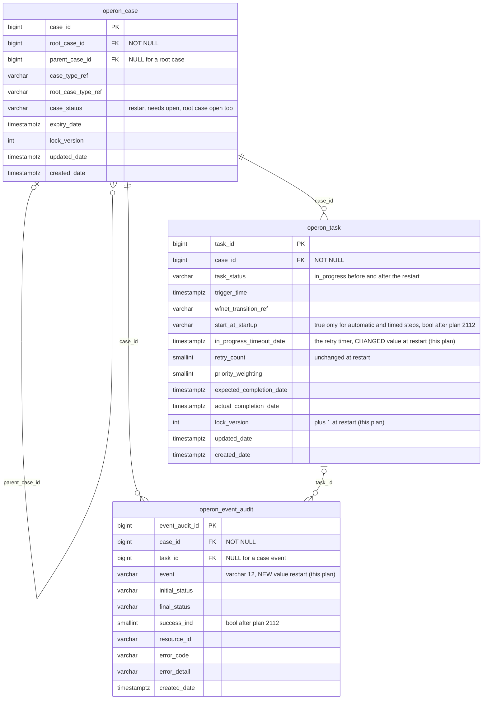
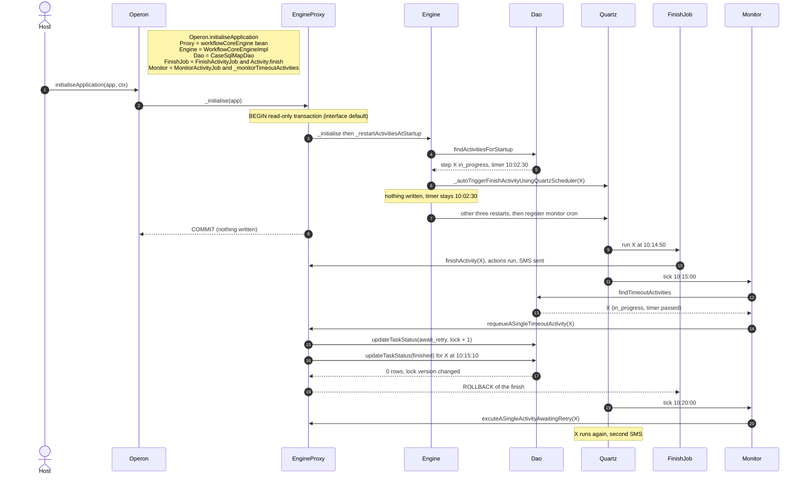
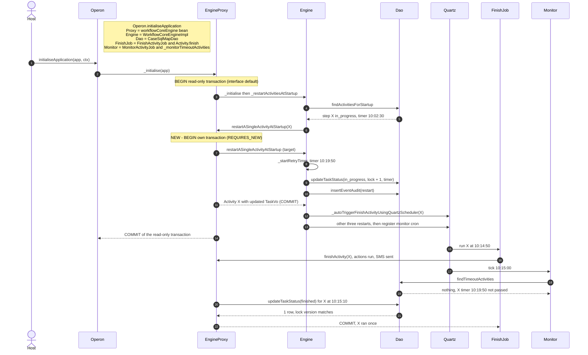
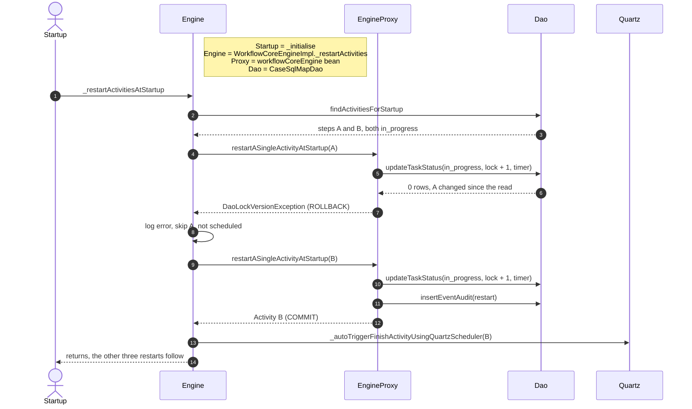

# Plan: Give a step that is restarted at server startup a fresh retry timer, saved before it runs again

**Status:** PLANNED

> **ON HOLD** — on hold: user rule, no feature behaviour changes (2026-11-26); not to be built unless the user reverses it.
> This plan changes how a step restarted at server startup is retried, i.e. how the retry feature behaves today.
> Its content is kept unchanged for reference.

## Context

Operon retries an automatic or timed step that does not finish in time. Each such step carries a "retry me if not finished by"
time (the retry timer, column `IN_PROGRESS_TIMEOUT_DATE`). A retry monitor runs on a cron (every 5 minutes in the test context),
finds steps that are running (`in_progress`) with that time in the past, queues them for a retry and runs them again on the next
tick.

When the server stops while a step is running (a crash, a power cut, a deploy), the step is left `in_progress`. At the next startup
`WorkflowCoreEngineImpl._restartActivitiesAtStartup` finds these steps and runs their work again. It writes nothing to the database
first, so each step keeps the timer it got when it originally started. After an outage longer than the step's time limit, that
timer is already in the past, and the first monitor tick after startup treats a step that the restart is running right now as
stuck. The step then runs a second time.

Example (derived from reading the code; not run): a "send the reminder SMS" step with a 5-minute limit starts at 09:57:30, so its
timer is 10:02:30. The server dies at 09:58 and comes back at 10:14:50. The restart sends the SMS again (20 seconds). The monitor
ticks at 10:15:00, sees "running and past 10:02:30", and queues the step for a retry. The restarted run then fails to save
`finished` (the queueing changed the row's lock version) and is rolled back, and the 10:20:00 tick runs the step again: the
customer gets a second SMS from the restart alone.

This was raised as Open question 2 of
[Start the retry timer when the step starts](261124-1715-start-the-retry-timer-when-the-step-starts.md). That plan fixes the
timer at a step's first start, but not on this restart path (its "What this plan does not fix" list). The owner decided on
2026-11-26 to handle it in this separate plan.

Intended outcome: each step restarted at startup gets a fresh timer (now plus its own execution time limit), saved in the database
**before** its work is scheduled, so the monitor leaves it alone for its full time limit. If the save fails for one step (for
example because its row changed in the meantime), that step is skipped and logged, and startup and the other steps carry on.

**What this plan cannot fix.** Operon cannot know whether the step's outside effect (the SMS, an email, a payment call) already
happened before the crash. Restarting a step still runs its actions again, so an effect that completed before the crash happens
twice. That is today's behaviour too; this plan removes only the *extra* run caused by the stale timer.

## Tables involved

The restart path reads `operon_task` joined to `operon_case` (unchanged query) and, after this plan, writes one `operon_task`
update and one `operon_event_audit` insert per restarted step, through existing statements. No table, column, index, constraint or
SQL statement is added or changed.

Names and types checked against `operon/src/resources/META-INF/db/postgres/operon-postgres-schema.sql` (lines 24-38, 54-71,
109-125) and the MySQL script (`operon-mysql-schema.sql:49-67, 110-127`); no database exists to read a catalog from yet (the Docker
database is [plan 261125-2111](../done/261125-2111-docker-postgres-database-for-dev-and-test.md)). Types are the Postgres script's, short
names.



**The restart changes no status: the step is `in_progress` before and after; only its timer, lock version and updated date move,
and one audit row records it.**

> ERD approved by operon (owning repo team), 2026-11-26.

| Part | Reads | Writes |
|---|---|---|
| `_restartActivitiesAtStartup` → `findActivitiesForStartup` (unchanged) | `operon_task`, `operon_case` | nothing |
| `restartASingleActivityAtStartup` (new) → `updateTaskStatus` (existing, `Case.xml:311-321`) | `operon_task` (by `TASK_ID` and `LOCK_VERSION`) | `operon_task` (update: timer, lock version, updated date) |
| `restartASingleActivityAtStartup` (new) → `insertEventAudit` (existing, `Case.xml:480-483`) | nothing | `operon_event_audit` (insert: one `restart` row) |

Which rows the restart selects (`Case.xml:367-377`, unchanged): `TASK_STATUS = 'in_progress'`, `START_AT_STARTUP = 1`, the case
`open` and its root case `open`. `START_AT_STARTUP` is set to true only for automatic and timed steps when they are created
(`WorkflowCoreEngineImpl.java:842-858`); every other step keeps the `TaskVo` default `FALSE` (`TaskVo.java:23`). So manual and
message steps are never selected (message steps also start and finish in one transaction, so they are never left
`in_progress`). Steps waiting for a retry (`await_retry`), suspended steps and steps of suspended, cancelled or closed cases are
not selected either.

`operon_task` — a step left running by a crash (**example**: no database exists yet; shown as Postgres prints it after
[plan 261125-2112](../261125-2112-convert-operon-from-mysql-to-postgres.md), times in UTC):

```
SELECT task_id, case_id, task_status, in_progress_timeout_date, retry_count, lock_version
FROM operon_task
WHERE task_id = 5310;

 task_id | case_id | task_status | in_progress_timeout_date | retry_count | lock_version
---------+---------+-------------+--------------------------+-------------+--------------
    5310 |    1042 | in_progress | 2026-11-26 10:02:30+00   |           0 |            1
(1 row)
```

## Approach

### Verified facts the design rests on (operon, owning team, 2026-11-26, by reading the code; nothing run)

The second reviewer's report was re-checked line by line; it holds.

- **Startup runs inside a read-only transaction.** `Operon.initialiseApplication` calls `_initialise` on the
  `workflowCoreEngine` bean (`operon/src/main/java/com/hoodox/operon/workflow/Operon.java:92-93`), which is the Spring
  `TransactionProxyFactoryBean` with an `AnnotationTransactionAttributeSource` (`operon/src/test/resources/META-INF/applicationContext.xml:15-20, 39-43`).
  `_initialise` (`WorkflowCoreEngine.java:249`) has no annotation of its own, so it inherits the interface's
  `@Transactional(readOnly = true)` (`WorkflowCoreEngine.java:23`): propagation `REQUIRED`, read-only, one transaction for the
  whole of `_initialise` (`WorkflowCoreEngineImpl.java:116-144`).
- **So a direct `caseDao` write inside `_restartActivitiesAtStartup` would not be committed before the work runs.** It would join
  that outer transaction, which commits only when `_initialise` returns, after all four restart calls and after the finish jobs
  have been handed to Quartz (they start at once on other threads). With the old MySQL driver (Connector/J 5.1.5,
  `operon/pom.xml:28`) the read-only flag is believed to be only a hint, so the write would sit uncommitted (holding the row
  lock the finish job then waits on); with Postgres after plan 2112 the driver runs the transaction `READ ONLY` and the update is
  refused. (Driver behaviour from their documentation, not run.) Either way the write must go through its own transaction.
- **A new `REQUIRES_NEW` method on the interface, called through the proxy bean, commits when it returns.** This is how the other
  startup restarts already write (`_startWorkItemsAndAutoTriggerFinishActivities` calls `fireTokensAtWorkItems`, `REQUIRES_NEW`,
  through the bean, `WorkflowCoreEngineImpl.java:1444-1447`). The proxy is a JDK interface proxy, so the method must be declared
  on `WorkflowCoreEngine`; calling it on `this` would skip the proxy and its transaction. The bean is reachable during
  `_initialise` because `initialiseApplication` stores the context first (`Operon.java:87`).
- **`_updateWorkItemStatus(in_progress → in_progress)` is a valid write.** `_updateWorkItemStatus`
  (`WorkflowCoreEngineImpl.java:1186-1205`) does not check transitions: it bumps `LOCK_VERSION` by 1 on the `TaskVo`, sets
  `updatedDate` and the status, calls `caseDao.updateTaskStatus` (which also writes `IN_PROGRESS_TIMEOUT_DATE` and `RETRY_COUNT`
  from the `TaskVo`, `CaseSqlMapDao.java:151-170`, `Case.xml:311-321`), and writes one audit row through
  `AuditImpl._auditEvent`. If no row matches the expected lock version, `updateTaskStatus` throws `DaoLockVersionException`
  (`CaseSqlMapDao.java:163-169`), a `RuntimeException`, so Spring rolls the new transaction back (default rule).
- **An event name is needed, and `restart` fits.** Events are plain strings in `Const.java:79-91`; nothing validates them
  (`AuditImpl._auditEvent` copies the string, `AuditImpl.java:45-80`; no check constraint or enum in either schema script).
  The column is `EVENT varchar(12) NOT NULL` in both scripts (`operon-mysql-schema.sql:114`, `operon-postgres-schema.sql:113`);
  `restart` is 7 characters. Statuses are `varchar(14)`; `in_progress` fits (and is already written today).
- **The finish job must carry the same, updated `TaskVo`.** `FinishActivityJob` → `Activity.finish` → `finishActivity` saves
  `finished` with the lock version held in the `Activity`'s `TaskVo` (`WorkflowCoreEngineImpl.java:190`). The proxy passes the
  same Java object to the target, so the `TaskVo` the restart method bumped is the one the caller schedules; the lock versions
  match.
- **Unlike the retry re-run, the work is scheduled only after the commit.** `excuteASingleActivityAwaitingRetry` schedules its
  finish job *inside* its own transaction (`WorkflowCoreEngineImpl.java:2405-2406`, before the method returns and commits).
  This plan does not copy that: the new method only writes and returns the `Activity`; the caller schedules it after the call
  has returned, so the fresh timer is committed first. (The retry path is left as it is; out of scope.)

### Decisions

- **Retry count: unchanged.** The count means "how many times the monitor re-ran this step because it ran out of time"
  (`excuteASingleActivityAwaitingRetry`, l. 2396; checked against the maximum at l. 2465). A restart is not a timeout: the server
  stopped, the step did not misbehave. Counting restarts would let a few deploys or crashes suspend a healthy step. Plan
  261124-1715 also keeps the count's meaning unchanged (its Requirement 2). Accepted residual: a step whose work itself crashes
  the server is restarted at every startup without limit, as today.
- **Order at startup: unchanged.** `_restartActivitiesAtStartup` stays the first of the four restart calls and stays outside the
  `try` that catches `ResourceAccessDeniedException` (`WorkflowCoreEngineImpl.java:125-138`). The monitor is registered last
  (l. 141), so every restarted step's fresh timer is committed before this server's monitor can tick. The first tick can still
  come seconds later (it follows the cron, not the startup time), which is exactly the case the fresh timer covers.
- **One step at a time: write, commit, schedule.** For each step: call the new method (own transaction), then schedule that
  step's finish job; then the next step. Each timer starts as close as possible to its own scheduling.
- **One step's failure does not stop the others.** Any `RuntimeException` for one step (lock-version clash, the step's net no
  longer loaded, a scheduler error) is caught and logged with the task id, and the loop carries on. This is a small behaviour
  change: today a missing case type in this loop throws out of `_initialise` and stops startup.
  - Write failed: nothing was saved (rolled back) and the step is not scheduled. With a lock-version clash the row was changed by
    someone else since the startup query (most likely another running server, or an old instance still finishing the step),
    so not running it is right.
  - Write saved but scheduling failed: the step stays `in_progress` with its fresh timer and no job; the monitor queues and re-runs
    it once that timer passes. Logged as such.
- **Manual and message steps are never touched.** The query already excludes them (see Tables involved). The new method also
  checks the trigger type and returns `null` (no write) for anything other than automatic or timed, so a wrongly flagged row
  cannot get a timer.
- **Reuse plan 261124-1715's helper.** `_startRetryTimer(TaskVo, Transition, long)` (added by that plan, after
  `_fireTokensAtWorkItem`) sets the timer to now plus the execution time limit for automatic and timed steps. This plan calls it;
  that is why it is sequenced after 261124-1715.

### Several servers on one database

`operon_task` has no server column and the Quartz store is in memory per server (`operon/src/test/resources/quartz.properties`:
`RAMJobStore`), so `findActivitiesForStartup` cannot tell a step left by a crash from a step that another, still running, server
is executing right now. This is unchanged by this plan:

- A server that starts while another is running restarts the other server's running steps, which then run twice (today and
  after). After this plan the restart's write bumps the lock version, so the other server's run fails to save `finished` and rolls
  back (its actions have already run); the restarted run finishes. Today either run can be the one that fails.
- Two servers starting at the same moment: if both read the step before either writes, the second write hits a lock-version clash
  and that server skips the step, so it runs once instead of twice (a small gain). If the second server reads after the first has
  committed, it sees a valid `in_progress` row and restarts it again. Not fixed here; a real fix needs a server or lease column.

### The code changes

Line numbers are today's; plan 261124-1715 inserts about 12 lines into `WorkflowCoreEngineImpl.java` above line 1540 first, so
the builder locates by method name.

**1. New event constant** — *Before*, `operon/src/main/java/com/hoodox/operon/helper/Const.java:91`:

```java
    public static final String TASK_EVENT_m_undo = "m_undo";    
```

*After*:

```java
    public static final String TASK_EVENT_m_undo = "m_undo";    
    public static final String TASK_EVENT_restart = "restart";
```

**2. New transaction boundary** — *Before*, `operon/src/main/java/com/hoodox/operon/workflow/WorkflowCoreEngine.java:221-222`:

```java
	@Transactional(readOnly = false, propagation = Propagation.REQUIRES_NEW)	
	public void requeueASingleTimeoutActivity(TaskVo workItemVo);
```

*After* (added after it):

```java
	@Transactional(readOnly = false, propagation = Propagation.REQUIRES_NEW)	
	public void requeueASingleTimeoutActivity(TaskVo workItemVo);

	/**
	 * <p>Do not use this!!! <b>Internal Use Only</b></p>
	 * Restarts an automatic or timed Activity found IN_PROGRESS at startup: sets its retry
	 * timer to now plus its execution time limit and saves it (lock version + 1, one
	 * "restart" audit row) in its own transaction, committed when this call returns.
	 * Does not schedule the Activity; the caller does that after this returns.
	 *
	 * @param workItemVo the row read by findActivitiesForStartup; updated in place
	 * @return the Activity to schedule, or null if the step is not automatic or timed
	 */
	@Transactional(readOnly = false, propagation = Propagation.REQUIRES_NEW)
	public Activity restartASingleActivityAtStartup(TaskVo workItemVo);
```

**3. The restart loop** — *Before*, `operon/src/main/java/com/hoodox/operon/workflow/WorkflowCoreEngineImpl.java:1540-1566`:

```java
	public void _restartActivitiesAtStartup() {
		TaskVo[] taskVos = this.caseDao.findActivitiesForStartup();

		log.info("Operon>>>>>>>>>>>>>>>>> There are  " + taskVos.length + " Activites that did not finish, will restart the Activities now if any......" + " <<<<<<<<<<<<<<<<<<<<<<<<");
		
		List<Activity> activityList = new ArrayList<Activity>();
		for (int i=0; i<taskVos.length; i++) {
			log.info("Operon>>>>>>>>>>>>>>>>> Restarting Activity  " + taskVos[i].getWfnetTransitionRef() + "_" + taskVos[i].getTaskId() + " <<<<<<<<<<<<<<<<<<<<<<<<");
			
			CaseVo caseVo = taskVos[i].getCaseVo();
			RootCaseType rootCaseType = this.caseTypeManager.getRootCaseTypeById(caseVo.getRootCaseTypeRef());
			if (caseVo.getCaseTypeRef().equals(caseVo.getRootCaseTypeRef())) {
				activityList.add(new Activity(this.applicationName, taskVos[i], rootCaseType));
			} else {
				CaseType caseType = rootCaseType.findSubCaseTypeById(caseVo.getCaseTypeRef());
				activityList.add(new Activity(this.applicationName, taskVos[i], caseType));
				
			}
		}
		
		Activity[] activities = activityList.toArray(new Activity[activityList.size()]);
		for (int i=0; i<activities.length; i++) {
			WorkflowCoreEngineImpl._autoTriggerFinishActivityUsingQuartzScheduler(activities[i]);
		}

		
	}
```

*After* — the find stays here; the loop moves to a package-private method so a test can run it on its own rows only:

```java
	public void _restartActivitiesAtStartup() {
		TaskVo[] taskVos = this.caseDao.findActivitiesForStartup();

		log.info("Operon>>>>>>>>>>>>>>>>> There are  " + taskVos.length + " Activites that did not finish, will restart the Activities now if any......" + " <<<<<<<<<<<<<<<<<<<<<<<<");

		_restartActivities(taskVos);
	}

	/**
	 * For each Activity: give it a fresh retry timer and commit that in its own
	 * transaction (through the proxy bean), then schedule its work. A failure on one
	 * Activity is logged and skipped; the others and the rest of startup carry on.
	 */
	void _restartActivities(TaskVo[] taskVos) {
		WorkflowCoreEngine workflowCoreEngine = (WorkflowCoreEngine) Operon.getInstance().getApplicationContext(this.applicationName).getBean(Const.APPLICATION_CTX_BEAN_NAME_workflowCoreEngine);

		for (int i=0; i<taskVos.length; i++) {
			String name = taskVos[i].getWfnetTransitionRef() + "_" + taskVos[i].getTaskId();
			log.info("Operon>>>>>>>>>>>>>>>>> Restarting Activity  " + name + " <<<<<<<<<<<<<<<<<<<<<<<<");

			Activity activity = null;
			try {
				//=================================
				// Fresh timer, committed when
				// this REQUIRES_NEW call returns
				//=================================
				activity = workflowCoreEngine.restartASingleActivityAtStartup(taskVos[i]);
			} catch (RuntimeException e) {
				log.error("Operon !!!!!!!!!!!!!!! Cannot restart Activity " + name + ", skipped (nothing saved, not run): " + e.getMessage(), e);
				continue;
			}
			if (activity == null) {
				log.warn("Operon !!!!!!!!!!!!!!! Activity " + name + " is not automatic or timed, not restarted");
				continue;
			}

			try {
				WorkflowCoreEngineImpl._autoTriggerFinishActivityUsingQuartzScheduler(activity);
			} catch (RuntimeException e) {
				log.error("Operon !!!!!!!!!!!!!!! Activity " + name + " has a fresh retry timer but could not be scheduled; the retry monitor will re-run it after its execution time limit: " + e.getMessage(), e);
			}
		}
	}

	public Activity restartASingleActivityAtStartup(TaskVo taskVo) {
		CaseVo caseVo = taskVo.getCaseVo();
		RootCaseType rootCaseType = this.caseTypeManager.getRootCaseTypeById(caseVo.getRootCaseTypeRef());
		CaseType caseType = rootCaseType;
		if (!caseVo.getCaseTypeRef().equals(caseVo.getRootCaseTypeRef())) {
			caseType = rootCaseType.findSubCaseTypeById(caseVo.getCaseTypeRef());
		}

		Transition transition = caseType.findTransitionById(taskVo.getWfnetTransitionRef());
		if (!Const.TRIGGER_TYPE_auto.equals(transition.getTriggerType())
				&& !Const.TRIGGER_TYPE_time.equals(transition.getTriggerType())) {
			return null;
		}

		TriggerContext triggerContext = new TriggerContext();
		triggerContext.setCurrentResource(_getAutoTriggerResource(caseType));

		//=================================
		// Retry timer = now + limit; status
		// stays in_progress, lock version + 1,
		// one "restart" audit row
		//=================================
		_startRetryTimer(taskVo, transition, System.currentTimeMillis());
		_updateWorkItemStatus(taskVo, triggerContext, Const.TASK_EVENT_restart, Const.TASK_STATUS_in_progress, null, this.caseDao);

		return new Activity(this.applicationName, taskVo, caseType);
	}
```

`_restartActivities` is package-private, not on the interface (no transaction of its own; it runs inside `_initialise`'s
read-only transaction, which it never writes through). `Operon`, `Activity`, `Transition`, `TriggerContext`, `CaseVo`, `TaskVo`,
`RootCaseType` and `CaseType` are already imported or in the same package. `List`/`ArrayList` stay imported (used elsewhere).

**4. Release note** — under the "operon (unreleased)" entry that plan 261124-1715 adds at the top of `operon/RELEASE_NOTES.txt`
(if it is not there, add that heading first), append:

```
* Behaviour change: a step restarted at startup gets a fresh retry timer *
A step that was running when the server stopped is restarted at the next
startup. Its retry timer is now reset to "restart time + execution time
limit", and saved, before it runs again; one "restart" event is audited.
Before, it kept its old timer, so after a long outage the first retry
monitor check could treat the restarted step as stuck and run it again.
If a single step cannot be restarted (for example its row changed in the
meantime), it is skipped and logged and startup continues.
A step's outside effects (SMS, email) may still happen twice if they had
already happened before the server stopped.
Host applications that wire the workflowCoreEngine proxy themselves must
take transaction settings from the annotations on WorkflowCoreEngine
(AnnotationTransactionAttributeSource, as in the test applicationContext.xml),
so the new restartASingleActivityAtStartup method gets its own transaction.
```

### Database tests and the Postgres plan

The new database test is written **once** and is not rewritten by
[Convert Operon from MySQL to PostgreSQL](../261125-2112-convert-operon-from-mysql-to-postgres.md) (an entry of the "Modernise Operon"
loop; this plan is standalone and outside that loop):

- It drives the engine and the DAO only, plus three plain `SELECT ... WHERE task_id = ?` / `count(*)` reads through a
  `JdbcTemplate` that run unchanged on MySQL and Postgres (no dialect-specific SQL, no boolean literals).
- It goes into `operon/src/test/resources/testng-db.xml`, the database suite that
  [plan 261125-2110](../done/261125-2110-rebuild-hoodox-commons-module.md) creates (its `db-tests` profile), not into `testng.xml`. Plan 2112
  makes that suite green on Postgres; it runs this test with no change.
- In practice the only test database being set up is the Docker Postgres of plans 2111 and 2112, so the test will most likely first
  run once 2112 is `DONE`. If this plan is built before that, its code and test are written but the database run waits, and this
  plan stays `IN PROGRESS` until it has run (see Dependencies). If 2112 lands first, its expected test count (`Tests run: 14`)
  grows by this plan's tests; whichever plan lands second states the new count.

## Scope

- **In:** `_restartActivitiesAtStartup` (steps already `in_progress` at startup); the new interface method and event constant; a
  database test that simulates a restart; a release note.
- **Out:** the other three startup restarts (they go through the normal start, fixed by plan 261124-1715); the retry count and
  maximum; the monitor query; the retry re-run scheduling inside its transaction; multi-server ownership of steps; knowing whether
  an outside effect already happened; the comment listing events in the MySQL script (`operon-mysql-schema.sql:114`, deleted by
  plan 2112).

## Sequence diagrams

> Diagram approved by operon (owning repo team), 2026-11-26.

### The server restarts with a step that was running when it stopped

Before (today): the restart writes nothing, so the first monitor tick sees the old timer and queues a step that is running.



After (this plan): steps 6-11 are NEW; the fresh timer is committed before X is scheduled, and the 10:15 tick leaves X alone.



### One step's restart write fails (new)

A brand-new branch, so only the After diagram. Startup and the other steps carry on.



## Database changes per scenario

All blocks are **example** or **derived**: no database exists yet (plan 261125-2111 sets one up), so nothing is **real**. They are
shown as Postgres prints them after plan 2112 (`set time zone 'UTC'`; `success_ind` as `t`/`f`). Names used below: step X =
`task_id` 5310 in case 1042; step A = `task_id` 5320 in case 1050. Blocks show only keys and the columns this plan reads or
writes; the other columns exist and are omitted (the ERD lists them).

### S1 — The server restarts with a step that was running when it stopped

**In plain words.** A step was halfway through sending an SMS when the server stopped. When the server comes back it runs the step
again. Today it does that without updating the step's "retry me if not finished by" time, which is long past, so the retry checker
thinks the step is stuck and runs it a second time. After this plan the server first saves a new "not finished by" time (now plus
the step's time limit) and one line in the step's history saying "restarted", and only then runs the step. Nothing else about the
step changes: it is still "running", and its retry count stays the same.

| | Today | After this plan |
|---|---|---|
| Is anything saved before the step runs again? | No | Yes: a new deadline and one history line |
| Does the first retry check after startup re-queue it? | Yes, if the outage was longer than its time limit | No, not before its new deadline |
| Does the retry count change? | No | No |
| Can the SMS still go out twice? | Yes, from the restart and again from the retry | Only if it had already gone out before the crash |

**Current data**

`operon_task` — step X, left running by the crash (**example**):

```
SELECT task_id, case_id, task_status, in_progress_timeout_date, retry_count, lock_version
FROM operon_task
WHERE task_id = 5310;

 task_id | case_id | task_status | in_progress_timeout_date | retry_count | lock_version
---------+---------+-------------+--------------------------+-------------+--------------
    5310 |    1042 | in_progress | 2026-11-26 10:02:30+00   |           0 |            1
(1 row)
```

`operon_event_audit` — step X's history so far (**example**):

```
SELECT event_audit_id, case_id, task_id, event, initial_status, final_status, success_ind
FROM operon_event_audit
WHERE task_id = 5310
ORDER BY event_audit_id;

 event_audit_id | case_id | task_id | event | initial_status | final_status | success_ind
----------------+---------+---------+-------+----------------+--------------+-------------
          88101 |    1042 |    5310 | new   | enabled        | enabled      | t
          88102 |    1042 |    5310 | fire  | enabled        | in_progress  | t
(2 rows)
```

**What happens**

Today's code runs no statement on this path. This plan runs, at 10:14:50, in one transaction committed before X is scheduled
(the existing statements `updateTaskStatus` and `insertEventAudit`, `Case.xml:311-321, 480-483`; values **derived** from the code):

```
UPDATE operon_task
   SET TASK_STATUS = 'in_progress', LOCK_VERSION = 2, UPDATED_DATE = '2026-11-26 10:14:50+00',
       RETRY_COUNT = 0, ACTUAL_COMPLETION_DATE = NULL,
       IN_PROGRESS_TIMEOUT_DATE = '2026-11-26 10:19:50+00'
 WHERE TASK_ID = 5310 AND LOCK_VERSION = 1;

INSERT INTO operon_event_audit (EVENT_AUDIT_ID, CASE_ID, TASK_ID, EVENT, INITIAL_STATUS,
       FINAL_STATUS, SUCCESS_IND, RESOURCE_ID, ERROR_CODE, ERROR_DETAIL, CREATED_DATE)
VALUES (88231, 1042, 5310, 'restart', 'in_progress', 'in_progress', true,
       '<auto-trigger resource id>', NULL, NULL, '2026-11-26 10:14:50+00');
```

`operon_task` — after the restart, today's code (**derived**: nothing is written):

```
SELECT task_id, case_id, task_status, in_progress_timeout_date, retry_count, lock_version
FROM operon_task
WHERE task_id = 5310;

 task_id | case_id | task_status | in_progress_timeout_date | retry_count | lock_version
---------+---------+-------------+--------------------------+-------------+--------------
    5310 |    1042 | in_progress | 2026-11-26 10:02:30+00   |           0 |            1
(1 row)
result: unchanged; the 10:15:00 monitor tick selects this row as timed out
```

`operon_task` — after the restart, this plan (**derived**):

```
SELECT task_id, case_id, task_status, in_progress_timeout_date, retry_count, lock_version
FROM operon_task
WHERE task_id = 5310;

 task_id | case_id | task_status | in_progress_timeout_date | retry_count | lock_version
---------+---------+-------------+--------------------------+-------------+--------------
    5310 |    1042 | in_progress | 2026-11-26 10:19:50+00   |           0 |            2 <- changed
(1 row)
result: committed before the finish job is scheduled; the 10:15:00 tick does not select it
```

Changed cells: `in_progress_timeout_date` (10:02:30 → 10:19:50) and `lock_version` (1 → 2); `task_status` and `retry_count` are
written with their old values.

`operon_event_audit` — after the restart, this plan (**derived**; today: unchanged, two rows):

```
SELECT event_audit_id, case_id, task_id, event, initial_status, final_status, success_ind
FROM operon_event_audit
WHERE task_id = 5310
ORDER BY event_audit_id;

 event_audit_id | case_id | task_id | event   | initial_status | final_status | success_ind
----------------+---------+---------+---------+----------------+--------------+-------------
          88101 |    1042 |    5310 | new     | enabled        | enabled      | t
          88102 |    1042 |    5310 | fire    | enabled        | in_progress  | t
          88231 |    1042 |    5310 | restart | in_progress    | in_progress  | t   <- new
(3 rows)
```

When the restarted run finishes at 10:15:10, the existing finish writes `finished` with `LOCK_VERSION = 3 WHERE LOCK_VERSION = 2`,
which matches, as on any normal finish.

READ only: `operon_case` (status of the case and its root, by the startup query). WRITTEN: `operon_task` (one update),
`operon_event_audit` (one insert). UNCHANGED: every other table.

### S2 — One step's restart write fails

**In plain words.** Between the moment the server lists the steps to restart and the moment it saves step A's new deadline,
something else changed step A (most likely another server that is still running it, or an old copy of this server finishing it).
The save is refused because step A is no longer what the server read. The server writes nothing for A, does not run it, notes the
problem in its log, and goes on with the next step and the rest of startup. Today the server would run A again without any check.

| | Today | After this plan |
|---|---|---|
| Is step A run again by this startup? | Yes | No |
| Is anything saved for step A? | No | No (the save is refused and undone) |
| Do the other steps and the rest of startup carry on? | Yes (nothing can fail here today) | Yes |

**Current data**

`operon_task` — step A as the startup query read it, and as it is now after the other server's write (**example**):

```
SELECT task_id, case_id, task_status, in_progress_timeout_date, retry_count, lock_version
FROM operon_task
WHERE task_id = 5320;

 task_id | case_id | task_status | in_progress_timeout_date | retry_count | lock_version
---------+---------+-------------+--------------------------+-------------+--------------
    5320 |    1050 | in_progress | 2026-11-26 10:03:10+00   |           0 |            2
(1 row)
```

The startup query read `lock_version` 1; the other server's write made it 2.

**What happens**

```
UPDATE operon_task
   SET TASK_STATUS = 'in_progress', LOCK_VERSION = 2, UPDATED_DATE = '2026-11-26 10:14:50+00',
       RETRY_COUNT = 0, ACTUAL_COMPLETION_DATE = NULL,
       IN_PROGRESS_TIMEOUT_DATE = '2026-11-26 10:19:50+00'
 WHERE TASK_ID = 5320 AND LOCK_VERSION = 1;
```

`operon_task` — after the statement, this plan (**derived**):

```
SELECT task_id, case_id, task_status, in_progress_timeout_date, retry_count, lock_version
FROM operon_task
WHERE task_id = 5320;

 task_id | case_id | task_status | in_progress_timeout_date | retry_count | lock_version
---------+---------+-------------+--------------------------+-------------+--------------
    5320 |    1050 | in_progress | 2026-11-26 10:03:10+00   |           0 |            2
(1 row)
result: UPDATE 0 -> DaoLockVersionException, transaction rolled back; A not scheduled, next step follows
```

Unchanged: nothing was added, because the write was refused; the audit insert never ran (it comes after the update in the same
transaction), so `operon_event_audit` has no `restart` row for task 5320. Today's code writes nothing here either and schedules A.

READ only: `operon_case`, `operon_task`. WRITTEN: nothing. UNCHANGED: `operon_task`, `operon_event_audit`.

## Implementation

**Folders touched** (no `.claude/rules/` exists in this repo):
- `operon/src/main/java/com/hoodox/operon/helper/` → no scoped rule
- `operon/src/main/java/com/hoodox/operon/workflow/` → no scoped rule
- `operon/src/test/java/com/hoodox/operon/workflow/` → no scoped rule
- `operon/src/test/java/com/hoodox/operon/actions/` → no scoped rule
- `operon/src/test/resources/` → no scoped rule
- `operon/` (`RELEASE_NOTES.txt`) → no scoped rule

**Flow:** see `## Sequence diagrams`

Start only when plans 261125-2110 and 261124-1715 are `DONE` (see Dependencies): `_startRetryTimer`, `ControllableAutoAction`,
`RetryTimerNet.xml` and `testng-db.xml` come from them.

1. Event constant (Approach → *The code changes* 1).
   - edit: `operon/src/main/java/com/hoodox/operon/helper/Const.java` — add `TASK_EVENT_restart = "restart"` after `TASK_EVENT_m_undo`.
2. Transaction boundary (Approach 2).
   - edit: `operon/src/main/java/com/hoodox/operon/workflow/WorkflowCoreEngine.java` — add `restartASingleActivityAtStartup`
     with `@Transactional(readOnly = false, propagation = Propagation.REQUIRES_NEW)` after `requeueASingleTimeoutActivity`.
3. Restart loop and the new method (Approach 3).
   - edit: `operon/src/main/java/com/hoodox/operon/workflow/WorkflowCoreEngineImpl.java` — replace the body of
     `_restartActivitiesAtStartup` as shown; add package-private `_restartActivities(TaskVo[])` and public
     `restartASingleActivityAtStartup(TaskVo)` directly after it. Do not change `_initialise` (call order stays), `_startRetryTimer`,
     `_updateWorkItemStatus`, `_autoTriggerFinishActivityUsingQuartzScheduler` or the retry methods.
4. Run counter for the test action.
   - edit: `operon/src/test/java/com/hoodox/operon/actions/ControllableAutoAction.java` (from plan 261124-1715) — if it has no
     run counter yet, add `static final AtomicInteger RUNS` incremented at the start of `execute`, and a `reset()` that zeroes it
     and sets the mode to succeed.
5. Restart-simulation database test.
   - new: `operon/src/test/java/com/hoodox/operon/workflow/RestartAtStartupWorkflowTest.java` (TestNG, extends `OperonBaseTest`,
     group `operon.workflow`, same package so it can call `_restartActivities`). Beans from
     `Operon.getInstance().getApplicationContext("tailorit")`: `workflowCoreEngineTarget`, `caseDao`, `dataSource` (wrapped in a
     `JdbcTemplate` for the three reads below). Cases are opened on `RetryTimerNet.xml` the same way `RetryTimerWorkflowTest`
     does (automatic step, 2 s limit). Helper `crashedStep()`: fail mode, open a case, wait 3 s; the first run has failed and
     rolled back, so the row is `in_progress` with a timer in the past and nothing running, which is exactly what a crash leaves;
     assert that state and that `caseDao.findTimeoutActivities()` contains it (the precondition of today's double run). Only the
     test's own rows are restarted: filter `caseDao.findActivitiesForStartup()` by the test's case ids and pass them to
     `_restartActivities`, so leftover rows from other tests are never run.
     - `restartedStepGetsAFreshTimerAndRunsOnce`: X = `crashedStep()`; note its lock version L; `reset()` then sleep mode 1.5 s;
       `findActivitiesForStartup()` contains X; call `_restartActivities({X})`. Right after it returns (the work is still
       sleeping): `select task_status, lock_version, in_progress_timeout_date, retry_count from operon_task where task_id = ?` →
       `in_progress`, L + 1, a timer later than the time before the call and at most 2 s after the time after it, retry count
       unchanged; `findTimeoutActivities()` does not contain X; call `_monitorTimeoutActivities()` → X still `in_progress` (not
       `await_retry`). Then poll up to 5 s: `finished`, retry count 0, `RUNS` = 1.
       `select count(*) from operon_event_audit where task_id = ? and event = 'restart' and initial_status = 'in_progress' and final_status = 'in_progress'` → 1.
     - `aFailedRestartWriteSkipsOnlyThatStep`: A = `crashedStep()`, B = `crashedStep()`; read A again
       (`findActivitiesForStartup()`, a separate object) and save it once with `caseDao.updateTaskStatus(copy with lock + 1, lock)`
       to play "another server changed A"; `reset()`; call `_restartActivities({A as first read, B})` → returns normally, no
       exception. A: lock version is the copy's (not bumped again), no `restart` audit row, still `in_progress`. B: `restart`
       audit row, then `finished` within 5 s. `RUNS` = 1 (B only).
     - Note in the class: A is left `in_progress` with an old timer; the context's real monitor later retries it in succeed mode.
       Like `RetryTimerWorkflowTest`, a real monitor tick (cron `0 0/5 * * * ?`) falling inside a test's few seconds could move a
       row early; the precondition asserts make that show as a clear failure, not a false pass.
   - edit: `operon/src/test/resources/testng-db.xml` — add the class (database suite, see Approach → *Database tests and the
     Postgres plan*).
6. Release note.
   - edit: `operon/RELEASE_NOTES.txt` — append the entry from Approach 4 under "operon (unreleased)".

## Verification

- Compile and the non-database suite (needs plan 2110's build): `mvn -B clean install` at the repo root → `BUILD SUCCESS`; the
  `operon` non-database tests still pass (`testng.xml` unchanged by this plan).
- Database suite, on the Docker Postgres (needs plans 2111 and 2112; on another database the same command with its
  `jdbc.properties`): `scripts/operon-db.sh reset && mvn -B -Pdb-tests -pl operon verify` → `RestartAtStartupWorkflowTest` passes
  (2 tests), and `WorkflowEngineTest` and `RetryTimerWorkflowTest` still pass; the surefire JVM exits by itself.
- A real restart through `_initialise` (the tests call the loop directly): the clash test leaves step A `in_progress` with an old
  timer when its JVM exits, which is what a crash leaves. Without resetting the database, run the database suite a second time
  (`mvn -B -Pdb-tests -pl operon verify`); its context load calls `_initialise`. Expect, if no monitor tick reached A in between:
  the log shows `Restarting Activity <transition>_<A's taskId>` with no stack trace, and the read-only query
  `select event from operon_event_audit where task_id = <A's taskId> order by event_audit_id` ends with `restart` (then `finish`
  once its succeed-mode run ends). If a tick did reach A first, A is no longer `in_progress` and the check is `NOT RUN`, said so.
- Code check: `git diff` touches only `Const.java`, `WorkflowCoreEngine.java`, `WorkflowCoreEngineImpl.java` (the restart methods
  only; `_initialise` unchanged), the test files above and `RELEASE_NOTES.txt`; `Case.xml`, `CaseSqlMapDao.java` and both schema
  scripts are unchanged.
- Not verifiable here: the multi-server behaviour and whether an outside effect happened before a crash (see Approach); the
  driver behaviour of a write in the read-only startup transaction (it is avoided, not tested).

## Risks & rollback

- **A host application that wires its own proxy differently** (method-name `transactionAttributes` instead of the annotation
  source) would give the new method no transaction; the write would then join the startup transaction and the old problem
  returns. The test context and the comment on `WorkflowCoreEngine` ("used in Spring for defining Transaction boundaries") use the
  annotations. The release note says so (last paragraph of the entry in Approach 4).
- **Startup does a little more work**: one extra short transaction (one update, one insert) per step restarted; normally few.
- **Behaviour change on bad data**: a step whose net is no longer loaded no longer stops startup; it is logged and skipped. Its
  row stays `in_progress`; a later monitor tick or startup will hit the same error on it.
- **Quartz queueing still uses the allowance**: the fresh timer starts at the write, so a restarted step that waits behind many
  other startup jobs for one of the 3 Quartz threads (test `quartz.properties`) can still run out of time while queued.
- **Test database leftovers**: the clash test leaves one row for the monitor to finish.
- Rollback: revert the commit. No schema or data migration; `restart` audit rows already written stay as history and nothing
  reads them.

## Dependencies

### Blocks this plan
- [Rebuild the missing private `hoodox-commons` jar as a module](../done/261125-2110-rebuild-hoodox-commons-module.md) (operon) — DONE (2026-11-27);
  **not blocking** any more (this plan stays on hold): without it the repo does not build or run any test; it also creates `testng-db.xml` and the `db-tests`
  profile this plan's test goes into.
- [Start the retry timer when the step starts](261124-1715-start-the-retry-timer-when-the-step-starts.md) (operon) — PLANNED, **on hold** (same user rule, 2026-11-26);
  **blocked** until DONE: this plan calls its `_startRetryTimer` helper, reuses its test net `RetryTimerNet.xml` and action
  `ControllableAutoAction`, and appends to its "operon (unreleased)" release-note entry. Both edit `WorkflowCoreEngineImpl.java`.
- [Convert Operon from MySQL to PostgreSQL](../261125-2112-convert-operon-from-mysql-to-postgres.md) (operon, entry of the
  "Modernise Operon" loop) — PLANNED; **proceed in parallel** for the code, with the caveat that the database test can only be
  run on a test database, and the only one being set up is its Docker Postgres; until one exists this plan cannot reach `DONE`.
  The test is written once and needs no change from 2112 (see Approach → *Database tests and the Postgres plan*). Plan 2112's own
  Dependencies were not edited (outside what the owner asked on 2026-11-26).

### Blocked by this plan
None.

## Status

- 2026-11-26 (operon): PLANNED — written by the owning team at the owner's request (Open question 2 of plan 261124-1715, owner's
  decision of 2026-11-26: a separate plan). Searched `todos/` (backlog included; no `done/` exists): nothing else covers the
  startup restart of `in_progress` steps. Premise and the second reviewer's transaction findings re-checked against the code and
  confirmed: `_initialise` is called through the proxy (`Operon.java:93`) and inherits `@Transactional(readOnly = true)`
  (`WorkflowCoreEngine.java:23, 249`), so the write goes through a new `REQUIRES_NEW` interface method called on the proxy bean
  per step, with the finish job scheduled after it returns using the same updated `TaskVo`. Event `restart` fits `EVENT
  varchar(12)` in both schema scripts; nothing validates event names or status transitions. Retry count kept unchanged
  (justified in Approach). Sequence diagrams and ERD drawn and self-approved by operon (owning team), checked with
  `h:mermaid-check`. Data rows are example/derived (no database yet). Standalone: not in the "Modernise Operon" loop; loop file
  not edited. Stays in `todos/backlog/`; picking it is the user's decision. Not approved.
- 2026-11-26 (operon): PLANNED, ON HOLD — on hold: user rule, no feature behaviour changes (2026-11-26); not to be built
  unless the user reverses it. The user ruled that the modernisation keeps every feature behaving as it does today, and this
  plan changes how the retry timer behaves after a restart. Technical content left unchanged; not deleted or archived.
  Dependency lines updated (2110 and 2112 now `PLANNED / NEEDS RE-REVIEW`, 1715 on hold). Owning-team re-review.
- 2026-11-26 (operon): PLANNED, ON HOLD — dependency tags only: 2110 and 2112 now `PLANNED` (re-review done). Still on hold; nothing else changed.
- 2026-11-27 (operon): dependency on 261125-2110 updated — it is DONE and archived to `todos/done/` (PR #1); links fixed. Still on hold.
